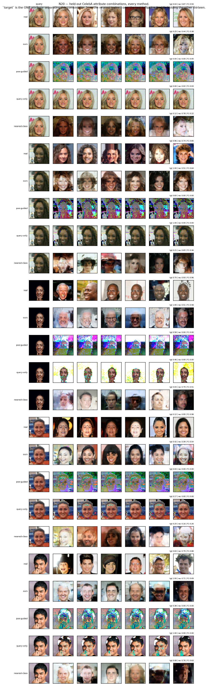
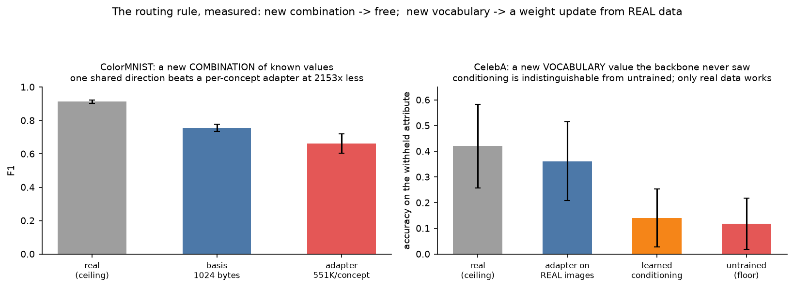
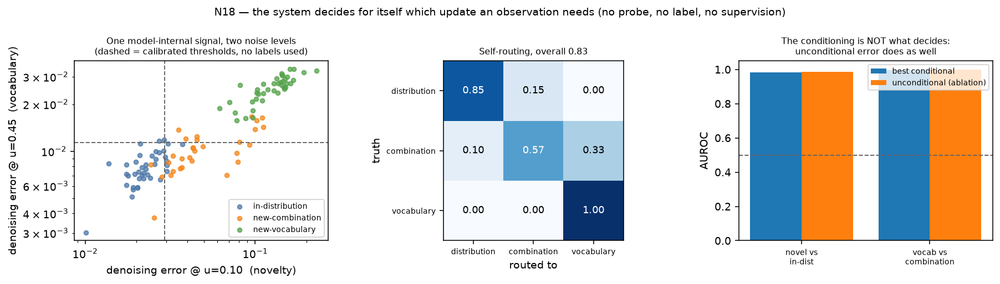

# Compositionality as the substrate for lifelong, incremental, out-of-distribution learning

A generative model meets one out-of-distribution query at a time, forever. It must produce the new
concept, keep it, and not damage anything it already had. This repository argues that **composition
is the mechanism that makes that possible**, and measures the argument on two benchmarks — one where
the factors occupy disjoint pixels and one where they overlap.


The loop is the method. A query arrives; the system decides *for itself* whether it is a new
**arrangement** of parts it already has or a genuinely new **part**; arrangements cost nothing and
parts cost a small kept delta; the result is registered and every earlier concept is certified
bit-identical. Nothing in the loop retrains the backbone.

**Relation to prior work.** Wang et al., *Test-Time Compositional Generalization in Diffusion Models
via Concept Discovery*, supply the first three stages (discover → select → compose → sample) and stop
where this repository begins: they distil one flat `(LoRA, c_new)` pair per query **and discard it**,
naming the gap in their own conclusion — *"a full mechanism for detecting, consolidating, and reusing
genuinely new primitives remains an important direction for future work."* Everything below the
composition stage is that mechanism.

---

## The argument, in six figures

### 1. Attribute accuracy cannot tell composing from copying. Coverage can.


This is the figure the project turns on. A method that re-emits the query scores **high attribute
accuracy** — the query is, after all, an image of the target — while covering none of the class. The
published method and the query-only baseline sit in the red band on **both** benchmarks. Any
evaluation that reports accuracy without coverage cannot distinguish them from a method that
actually composes.

### 2. Composition recovers combinations that were never observed


ColorMNIST F1 **0.502 ± 0.036** against the published method's **0.007 ± 0.007**. In the case study
the failure is visible rather than tabular: the `poe-guided` row is the query plus speckle, eight
times over.

On CelebA the split is stronger — `Smiling` and `Big_Nose` **never co-occur** in training, though each
appears alone tens of thousands of times, and they share the lower face. Producing both at once
scores **0.903 ± 0.094** where retrieval from the nearest trained combination reaches **0.355 ±
0.186**, and retrieval falling short is structural: every trained neighbour differs on at least one
of the two.



### 3. The routing rule: arrangements are free, parts are not



A new **combination** of known factor values costs **one 256-float direction (1024 bytes)**, shared by
every combination that uses it, against 551K parameters for a per-concept adapter — and it is a basis
rather than a lookup, because combinations it was never taught on score the same as the ones it was.

A new **vocabulary item** is different, and the two benchmarks agree. On a backbone that never saw the
value, composing it scores **exactly 0.000** (ColorMNIST) and a learned conditioning vector is **not
separated from an untrained one** (CelebA). Only a weight update from **real** data recovers it.
Feeding a model its own samples cannot help: a composed pool delivers bit-exactly zero gradient.

### 4. Preservation is structural, not engineered


Arms that structurally *remove* shared parameters sit at exactly **0.000** forgetting on both
benchmarks; every arm that tries to *protect* them forgets (EWC 0.070, finetune 0.091, replay 0.183).
`tests/test_unbounded.py` holds the stronger form: after 12 batches out to 40 concepts, every earlier
concept's epsilon output on fixed noise is **bit-identical**, not merely close.

The reason is one sentence, and it took four failed attempts to find: **conditionality, not size, is
what buys preservation.** Every route that removes the ability to switch a delta off collapses
(merged low-rank 0.379, merged orthogonal 0.069, hypernetwork 0.073, classifier guidance 0.000).

### 5. Is a consolidated concept as good as one the model was trained on?


The comparison the thesis is named after, and it needs an oracle: a backbone **trained on the
held-out slots**, which validates itself by sitting at the data ceiling. A concept consolidated from
a single query at zero retraining reaches most of native-level **coverage** and does not reach native
per-sample **precision**. The published per-query LoRA reaches neither.

### 6. The system routes itself, and cost grows with vocabulary rather than time




AUROC **0.980** novel-vs-in-distribution and **0.995** vocabulary-vs-combination, from the model's own
denoising error and no labels. The error is one-sided in the safe direction: a new vocabulary item
was routed to the free path **0 times in 120 queries**, while some combinations over-spend on an
adapter they did not need.

Charging that measured error back in, a 160-experience stream costs ~10× less than one adapter per
query, and the curve's slope is set by a *detector error rate* rather than by the arrival of
experiences. That is what makes "forever" the operative word.

**All numbers with error bars: [TABLES.md](TABLES.md). Full record, including every refuted
hypothesis: [RESULTS.md](RESULTS.md).**

---

## What is *not* claimed

Kept here rather than in a footnote, because several shaped the design.

- **The hierarchy does not earn its keep.** Given its best case, `clustered` placement is the *worst*
  arm (0.831) against `shuffled` (0.859) and `flat` (0.842) at identical parameter counts. The method
  is flat and insert-only as a result.
- **Consolidated concepts do not make later learning cheaper** on ColorMNIST — not in accuracy
  (selection frequency 0.00) and not in cost (`hier` vs `unfrozen` differ by 30× less than the seed
  spread). Likely a property of separable factors; stated as open.
- **The router is a density detector, not a basis test.** Its unconditional ablation matches the
  conditional signal, so it is *not* evidence that the factor basis recognises what it can express.
- **Composed samples cannot be sampled into the class.** The conditioning span can express one factor
  or the other but not both for a held-out pairing; an oracle fitted on 64 real held-out images does
  no better than inverting from one query. Thirteen interventions on the optimizer, objective, prior
  and sampler could not move it.
- **On CelebA the factor basis is supplied, not discovered.** A per-class embedding is untrainable at
  this data scale (measured: 34% of ceiling, unmoved by 2.3× data), so conditioning is factored by
  construction. CelebA tests whether composing known values *renders* when they overlap — not whether
  the basis can be found.

## Reproducing

```bash
bash reproduce.sh tests       # 7 assertions, no backbone needed
bash reproduce.sh backbones   # the 5 checkpoints everything else loads (~12 GPU-hours)
bash reproduce.sh colormnist  # ColorMNIST experiments, 3 seeds
bash reproduce.sh celeba      # CelebA experiments, 3 seeds
bash reproduce.sh analytic    # the analytic track (no gradient descent anywhere)
bash reproduce.sh figures     # aggregate + every figure + TABLES.md   (CPU, seconds)
```

Every figure and every table is generated from `results/aggregate.json` by
`experiments/make_paper_figures.py` and `experiments/make_paper_tables.py`, so a number in a figure
and the same number in a table cannot drift apart. Nothing in `figures/` is hand-drawn.

**Environment.** `chunks` conda env (torch 2.7.1+cu126) for the neural track; `cobweb` (numpy only,
no torch) for the analytic track. Data: MNIST idx files, and CelebA as HuggingFace parquet shards in
`data/celeba/`.

**Two things that will otherwise cost you hours.** The login node has no GPU and no torch, so
everything goes through `sbatch`. And stale `__pycache__` on NFS silently runs old code —
`reproduce.sh` clears it before every submission wave.

## Layout

```
lifelong_ood/          the method
  score.py             BaseScoreField: a diffusion manifold is one primitive, eps(x, u)
  compose.py           discovery, submodular selection, per-dimension product of experts
  neural/adapters.py   the insert-only adapter bank; preservation lives here
  neural/idealwords.py the factor basis, basis extension, new-vocabulary learning
  neural/router.py     the self-routing detector
experiments/           one file per experiment; e* analytic, n* neural
tests/                 7 assertions, including the two that caught real bugs
results/               per-run JSON + aggregate.json (the source for every figure and table)
figures/               f1-f10, all generated
```

## A note on measurement

Three bugs in this round were caught by a **control row** rather than by a result, and all three had
a plausible innocent explanation that would have been believed:

- a training path that used a different pixel layout than the sampler — visible because
  controllability was *exactly* 0.000 on eight of eight attributes, which is too clean for
  undertraining;
- a probe-readability filter that admitted five probes unable to recognise their own attribute
  (Gray_Hair: 0.962 accuracy, 0.321 true-positive rate on a 4.3%-prevalence attribute);
- smoke runs writing to the same files as full runs, so a 2-case result silently replaced a 12-case
  one.

Each showed up as *every arm moving together*, which reads as "the method does not work" rather than
"this measurement is invalid" — the most expensive confusion available. The habit that caught them is
printing the real-data ceiling beside every method, and it is why every table here carries one.
`tests/test_layout.py`, `probe_usable()` and the `--tag _smoke` convention are the permanent guards.
