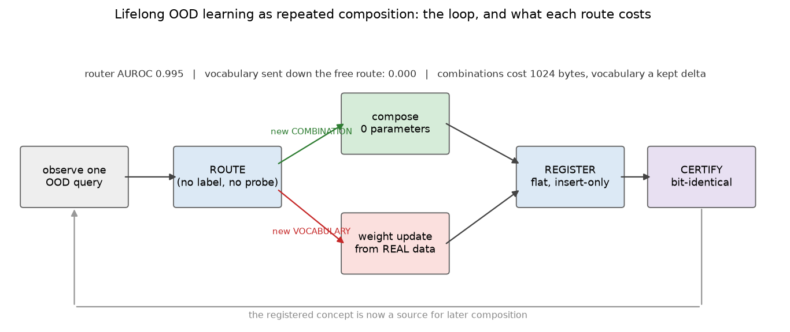
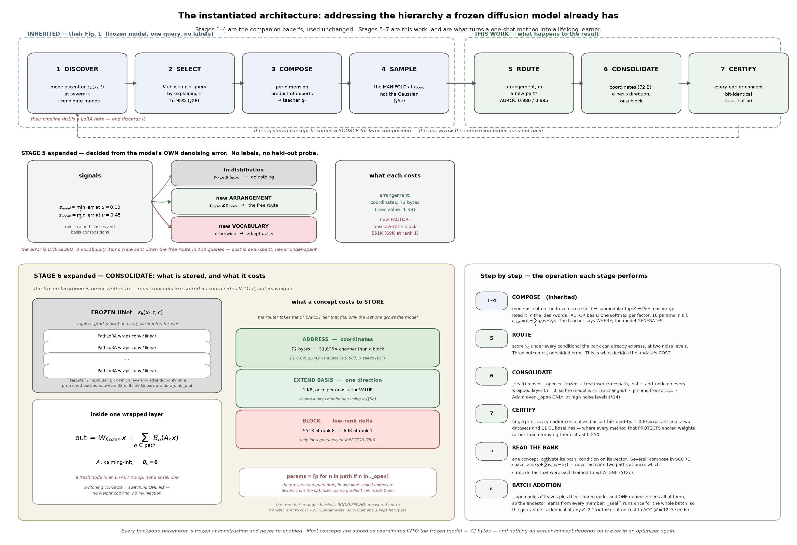
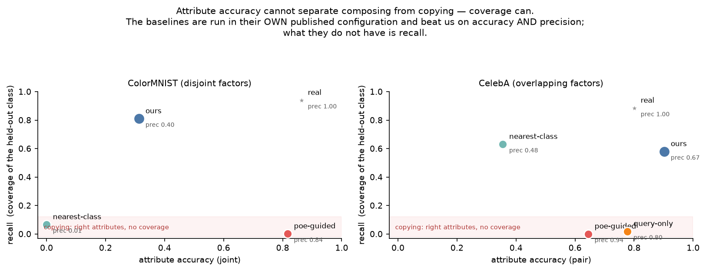
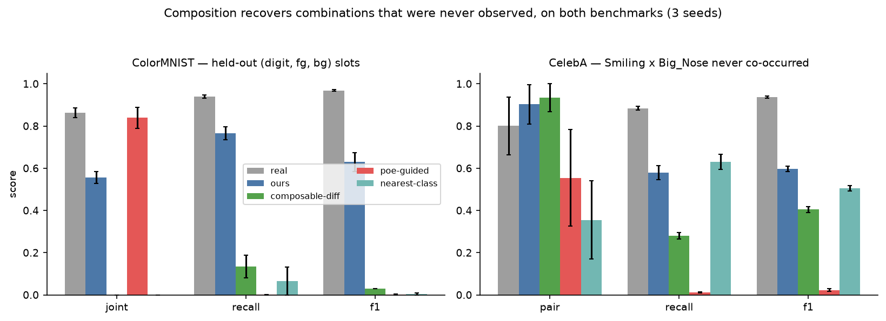
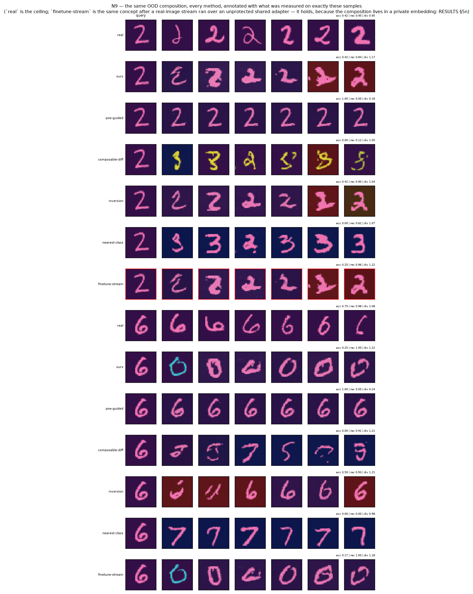
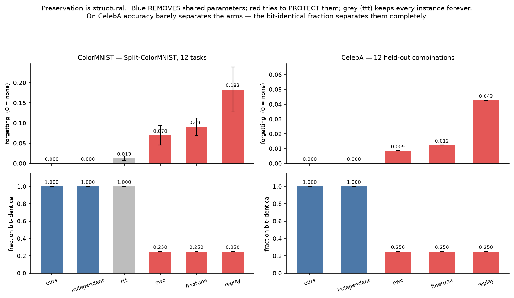
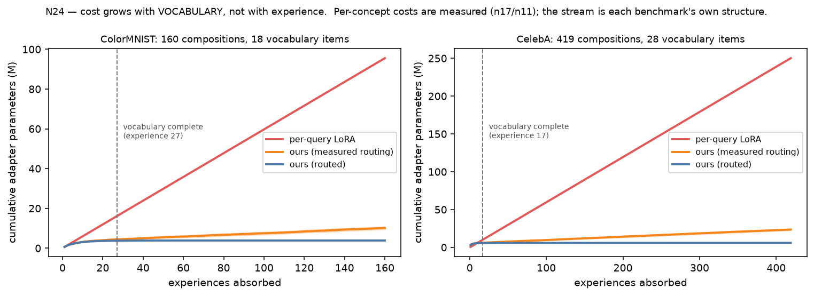
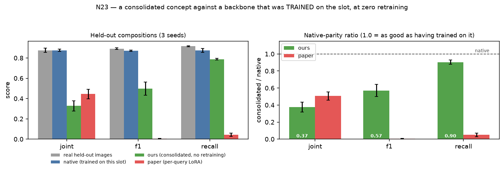
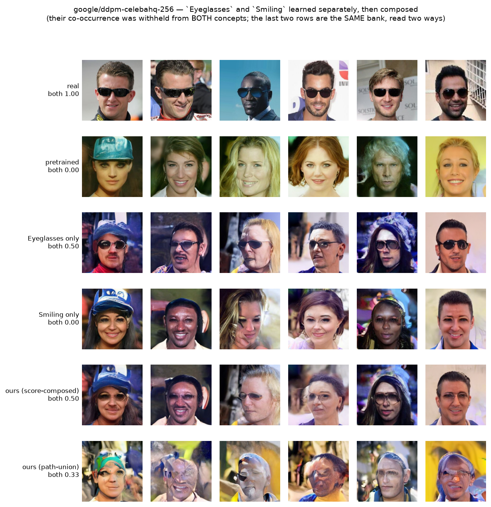

# Compositionality as the substrate for lifelong, out-of-distribution learning

A generative model meets out-of-distribution queries **forever**. Each one must be produced, **kept**,
and must not damage anything kept before — at a cost that grows with the model's *vocabulary* rather
than with its *history*.

This repository argues that **composition is the mechanism that makes that possible**, and measures
the argument on two benchmarks (one where the factors occupy disjoint pixels, one where they overlap)
and on a pretrained 113.7M-parameter diffusion model we did not train.

## The architecture in one table

Every arriving concept is priced by a router, and **only the last tier grows the model**:

| tier | when it applies | cost | measured |
|---|---|---|---|
| **ADDRESS** | anything the factor basis already spans | **72 bytes** | **31,895× cheaper** than a block, and not worse — F1 0.678 ± 0.042 vs 0.587 ± 0.020 over 3 seeds (§25) |
| **EXTEND BASIS** | a new *value* of a known factor | **1 KB** | F1 0.755 ± 0.037 at zero per-concept parameters, beating per-concept adapters at 0.658 (§5q) |
| **BLOCK** | a genuinely new *factor*, or nothing factored | **69K** (rank 1) | the tier is real: conditioning-only routes score **0.000** here (§5q) |

That is the whole thesis operationally. **Cost tracks the world's vocabulary, not the length of the
stream** — routing an arrangement to the basis rather than a block is a **538×** difference, and it
is the piece with no counterpart in the companion paper, whose pipeline spends a full LoRA on every
query. Twenty-four concepts stored by addressing cost **1.7 KB** against **55 MB** of blocks, and the
backbone is not merely preserved but never written to at all.

**ADDRESS is the default; BLOCK is the exception the router escalates to.** Three caveats travel with
the claim and are not buried: it needs a factor basis to exist (there is none on an unconditional
pretrained model, §12); growth is monotone rather than constant, flattening only if vocabulary is
finite; and both escape hatches are damaged — repeated merges destroy the model (§5r, 0.837 → 0.073)
and deletion reclaims a median 0.250 of a path (§22a).




The full architecture, laid out against Figure 1 of the companion paper — their four stages unchanged in the top band, ours beside them, and the bank opened up to the tensors:



---

## How this branches off Wang et al.

**[Test-Time Compositional Generalization in Diffusion Models via Concept Discovery](https://arxiv.org/abs/2605.07078)
(Wang, Gupta, Zhu, MacLellan) is a companion paper from our own group.** This work is not a
competitor to it; it is a continuation of it, and the composition machinery is used unchanged.

**What they built.** Given one out-of-distribution query and a frozen diffusion model:

```
mode-ascent discovery on the model's own score field
   → submodular selection of K prototypes
   → per-dimension product-of-experts teacher
   → classifier-free guidance toward it (their Eq. 13, with the Eq. 14 variance-aware schedule)
   → optionally distil the result into one LoRA + one embedding
```

It answers *can a frozen model be steered to render a combination it never saw?* — and the per-query
LoRA is then **discarded**. There is no second query in the protocol.

**Where we pick it up.** Their limitation section names the gap exactly:

> *"A full mechanism for detecting, consolidating, and reusing genuinely new primitives remains an
> important direction for future work."*

We keep their four stages and add a fifth and sixth, which is what turns a test-time trick into a
lifelong learner:

```
for each arriving query, forever:
    COMPOSE   their four stages, unchanged
    ROUTE     price the arrival from the model's own denoising error — no labels
    STORE     at the CHEAPEST tier that can hold it:
                 ADDRESS        72 B   the factor basis already spans it →
                                       store coordinates, move no parameter at all
                 EXTEND BASIS    1 KB  a new VALUE of a known factor →
                                       one shared direction, amortized over every
                                       later concept that uses that value
                 BLOCK          69 K   a new FACTOR, or nothing factored →
                                       a low-rank block: THE ONLY TIER THAT GROWS THE MODEL
    CERTIFY   every previously stored concept is checked bit-identical
```

**ADDRESS is the default and BLOCK is the exception**, which is the inversion the companion paper's
pipeline makes: it spends a full LoRA on every query. Cost then tracks the world's *vocabulary*
rather than the length of the stream, because only the third tier is a function of arrivals.

---

## Why a bank instead of a pile of LoRAs — and what the evidence actually supports

The companion paper's endpoint is a **standalone adapter**: one LoRA distilled per query, complete in
itself, then discarded. The obvious lifelong extension is to keep them — a growing pile of
independent adapters. This repository is *in lieu of* that, and the reason is **cost growth**: a
lifelong learner has to absorb an unbounded stream without its parameter count growing with its
history.

**1. The backbone is the substrate, not a starting point.** A concept is never a model; it is a small
conditional *edit* to a frozen score field that already knows how to render. Everything a concept
does not have to relearn — strokes, shading, the image manifold — it gets by running *through* the
backbone.

**2. Most arrivals should not cost an adapter at all.** This is where the growth curve is actually
won. The router decides, from the model's own denoising error and with no labels, whether a query is
a new *arrangement* of known parts or a genuinely new *part*:

| route | cost | |
|---|---|---|
| already in distribution | **0** | do nothing |
| new arrangement | **1024 bytes** | extend the shared factor basis |
| new part | one low-rank block | the only case that grows the model |

That is a **538×** difference between the two update kinds, which is what makes cost track
*vocabulary* rather than *experience* — a 160-experience stream costs ~10× less than one adapter per
query (§6c), and the slope is set by a detector error rate rather than by arrivals.

**3. And a concept need not cost weights at all.** Our group's ACS paper argues that a diffusion
model's noisy marginals *are* a Cobweb hierarchy — each noise level is a kernel density estimate of
the data at a different bandwidth, and their modes are the prototypes. If so the hierarchy is
**already inside the frozen backbone**, and a lifelong learner should *address* it rather than build
another one out of adapters. Storing a concept then means storing **where it lives** in the model's
own conditioning space:

| what arrived | stored as | cost |
|---|---|---|
| a combination of known factor values | factor coordinates | **72 bytes** |
| a new *value* of a known factor | one basis direction | 1024 bytes |
| a new *factor*, or nothing factored | a low-rank block | the only case that grows the model |

Measured over 24 concepts (§25): **72 bytes per concept against 2,296,467 — 31,895×** — with the
backbone not merely preserved but **never written to at all**. Twenty-four concepts cost 1.7 KB.
Across **three seeds** (§25) addressing scores **F1 0.678 ± 0.042** against **0.587 ± 0.020** for a
full rank-8 block and **0.643 ± 0.042** for rank 1, winning in *every* seed against both (+0.091 and
+0.035 paired). Read that as *addressing costs 31,895× less and is not worse*; the margin over rank 1
is consistent in sign but smaller than the seed spread. The limit is real and stated: a genuinely new
*factor* still needs a block, where conditioning-only routes score 0.000.

**4. What a new part costs, when one is needed, is a knob currently set too high.** A block at rank 8 is 551K
parameters; at **rank 1 it is 69K**, and across three seeds the accuracy is indistinguishable
(0.840 ± 0.009 vs 0.842 ± 0.026) with bit-identity 1.000 at every rank (§24d). Flat placement costs
~20% less again. **Flat + rank 1 is 9.8× cheaper than this repository's default at no measured cost
— 75K per concept against 735K.**

**5. Preservation is the sealing discipline, and it is free.** Sealed nodes are absent from every
future optimizer, so nothing an earlier concept depends on can move. That is a property of *how the
optimizer is scoped*, not of how concepts are arranged.

### What the hierarchy is, honestly

Concepts are placed in a tree and a concept's adapter is the sum along its root-to-leaf path. The
hope was that ancestors would amortize storage and transfer structure to newcomers. **Neither has
survived measurement**, and the reader should not treat the tree as central:

| claim | status |
|---|---|
| shared nodes exist and carry signal | holds — a group node carries 2.3× a leaf's magnitude |
| shared nodes are formed from several members | holds — top-influence instances span 4 concepts |
| the tree **saves** parameters | **false** — every node costs a full block, so depth *adds* ~23% |
| ancestors **transfer** to a newcomer | **not supported** — routing through the matched family ties having no ancestor |
| depth organizes abstraction coarse→fine | **refuted** (§24c) |
| the placement rule clusters at all | **refuted** — 0.27 purity against a 0.25 random baseline (§24g) |

The placement defect is understood and fixable — Cobweb's category utility raises purity to 0.60
against an offline oracle's 0.66 (§24j) — but a better-shaped tree bought **no** downstream gain
(n5 ACC −0.017, n9 F1 +0.026, both inside error bars) at +23% parameters. So the tree is presented
here as **bookkeeping that makes paths expressible**, not as a contribution. What is load-bearing is
sealing plus routing, and the architecture the evidence supports is **flat, low-rank, and routed**,
with at most a per-batch group node (§15, the one place sharing measurably pays).

### Ground-up or finetuning? Both, in a specific division of labour

To be precise about the training regime, since "adapter" usually implies finetuning someone else's
model: the **backbone** is trained ground-up, once, by us — `n1_train.py` / `n19_celeba_train.py`,
from scratch, on the *seen* slots only (held-out combinations are excluded before training; that is
what makes them OOD). The pretrained track (§12) swaps in `google/ddpm-celebahq-256`, someone else's
weights, to show the mechanism does not depend on our having trained the substrate. The **lifelong
phase** — everything this repository actually claims — is then strictly additive adaptation on that
frozen backbone: no gradient ever reaches a backbone parameter, on any path, at any point. The CL
baselines in §5 finetune copies of the *same* backbone, so the comparison is between update
disciplines, not between pretraining recipes. One nuance the pseudocode below can obscure: in the
OOD composition loop the leaf distils a *sampled pool*; in the class-incremental tables (§5) the
router has decided the data is a new part, and the leaf consolidates the task's *real images*
directly. Same bank, same guarantee — what changes is only where the training set comes from.

---

## The method in pseudocode

What is actually stored, what is actually touched, and what is provably not.

### The state that persists between queries

```python
BACKBONE  eps_theta(x_t, t, c)         # a UNet, FROZEN forever. requires_grad_(False) on every
                                       # parameter at construction and never re-enabled.
                                       # Its class-embedding table has a NULL row: conditioning on
                                       # that row IS the unconditional model.

BANK = HierarchicalAdapterBank:
  .wrapped   [PathLoRA]                # every targeted nn.Linear / nn.Conv2d of the backbone,
                                       # replaced in-place by a wrapper. `targets`/`exclude` pick
                                       # which: all of them on our UNet, attention-only on a
                                       # pretrained one (32 of its 58 Linears are time_emb_proj,
                                       # and adapting the noise-level path destroys the model).
  .state["path"]  [node_id]            # THE ACTIVE PATH. One shared mutable list. Switching
                                       # concepts is switching this list — no weight copying,
                                       # no re-injection, no forward-pass branching.
  .tree      ConceptTree               # insert-only. node_id -> children. Never merged, never split.
  .concepts  {name: (path, leaf)}      # path = root..leaf node ids for that concept
  .frozen    {node_id}                 # sealed by an earlier insertion: NEVER in an optimizer again
  ._open     {node_id}                 # created by the insertion in progress: the only trainable set
  ._emb_extra {name: vector[d_emb]}    # the concept's conditioning vector

FACTOR_BASIS = factorize(C, labels)    # ideal words, fit ONCE by ridge regression on the backbone's
                                       # own trained class embeddings C:
                                       #     C[i] ~ mu + sum_f V[f][ label[i][f] ]
                                       # V[f] is [n_values_f, d_emb]. R^2 = 0.826 on ColorMNIST.
                                       # This is what makes a factor addressable at all.
```

Inside one wrapped layer, the delta is a **sum over the active path** — which is why a concept is
its ancestors plus its leaf, and why an unrelated concept contributes exactly zero:

```python
class PathLoRA(base_layer):            # base_layer.weight is frozen
    A, B = ParameterDict(), ParameterDict()      # keyed by node_id

    def add_node(nid):
        A[nid] = kaiming_uniform(rank, fan_in)
        B[nid] = ZEROS(fan_out, rank)            # <- a fresh node is an EXACT no-op, not a small one

    def forward(x):
        out = base_layer(x)                      # frozen weights
        for nid in BANK.state["path"]:           # <- only the active path contributes
            if nid in A:
                out = out + B[nid] @ (A[nid] @ x)
        return out
```

### One query

```python
def absorb(x_q):
    # ── 1. ROUTE ────────────────────────────────────────────────────────────
    # No labels. Score x_q under every conditional the bank can already express and take the best
    # denoising error, at two noise levels chosen by tests/diag_router_signals.py.
    s_novel = min_c  E_eps[ || eps_theta(noise(x_q, u=0.10), c) - eps ||^2 ]   # over trained classes
    s_vocab = min_c  E_eps[ || eps_theta(noise(x_q, u=0.45), c) - eps ||^2 ]   # over basis compositions

    if   s_novel <= t_novel:  return                      # already in distribution: do nothing
    elif s_vocab <= t_vocab:  tier = "ADDRESS"             # the basis SPANS it: 72 bytes, no weights
    else:                     tier = "EXTEND or BLOCK"     # the basis lacks something

    # HONEST GAP, stated because it is load-bearing: this router has three outcomes, and its third
    # lumps EXTEND BASIS and BLOCK together.  Nothing here yet distinguishes "a new VALUE of a known
    # factor" (1 KB) from "a genuinely new FACTOR" (69K) -- a 69x difference in cost decided by hand.
    # The detectable version is testable and unbuilt: does the residual after the best basis fit lie
    # INSIDE the span of the existing factor directions (a new value) or outside it (a new factor)?
    # What IS measured is that the distinction is real, not how to detect it (§5q).

    # ── 2. COMPOSE — read the query IN THE FACTOR BASIS ─────────────────────
    # Not a free vector, and not a weighting over the ~120 entangled class embeddings: one softmax
    # per factor, so 10 + 4 + 4 = 18 parameters. Composition is structural rather than something
    # the optimizer has to discover, and 18 parameters are determined by a SINGLE image where 120
    # would not be.
    w = [softmax(logits_f) for f in factors]              # learned by inversion through the FROZEN model
    c_new = mu + sum_f  gain[f] * (w[f] @ V[f])           # gain[f] calibrated on TRAINED slots, label-free

    if tier == "ADDRESS":
        STORE[name] = (w, gain)                           # 18 floats = 72 BYTES. Return here.
        return                                            # nothing below this line runs, and no
                                                          # parameter anywhere has moved.

    if tier == "EXTEND BASIS":                            # a new VALUE of a known factor
        V[f] = concat(V[f], new_direction)                # 1024 bytes, learned from REAL images
        # Measured, and it is why this tier cannot be folded into ADDRESS: a genuinely new VALUE
        # cannot be composed out of existing directions — conditioning-only routes score 0.000
        # (§5q). It needs a weight update, and the pool must be REAL data: distilling the composer's
        # own samples inherits the ceiling of whatever generated them. Once the direction exists,
        # every later concept using that value is back to tier 1 and costs 72 bytes.

    # tier == "BLOCK" falls through to the distillation below — the only path that grows the model.

    # ── 3. SAMPLE the pool FROM THE MANIFOLD, not from the teacher ──────────
    # The PoE teacher is a unimodal Gaussian: guiding toward it collapses every trajectory onto its
    # mean (recall 0.00 in every configuration tried, §5e). So the teacher decides WHERE the concept
    # is and the model's own conditional generates it.
    pool = sample(eps_theta, cond=c_new, guidance=1.5)     # guidance calibrated on TRAINED slots

    # ── 4. CONSOLIDATE — the only place any parameter moves ─────────────────
    BANK._seal()                                  # everything _open from the last insertion joins
                                                  # .frozen. After this line it can never be trained
                                                  # again, by ANY future concept.
    path, leaf = BANK.tree.insert(mean(pool))     # insert-only placement
    BANK._open = {leaf}
    for nid in path:
        for layer in BANK.wrapped: layer.add_node(nid)     # B = 0, so the model is UNCHANGED so far
    BANK._emb_extra[name] = c_new                 # pinned, and frozen during distillation: the
                                                  # adapter is a residual to the ACTUAL composition

    params = [p for nid in path if nid in BANK._open for p in (A[nid], B[nid])]
    #        ^^^^^^^^^^^^^^^^^^^^^^^^^^^^^^^^^^^^^ THE PRESERVATION GUARANTEE, in one line.
    #        Ancestors are in .frozen, so they are not in `params`, so no gradient can reach them.
    #        Not a penalty, not a small learning rate — the parameters are absent from the optimizer.
    Adam(params).minimize( ||eps_theta(noise(pool), c_new) - eps||^2 )
    #   noise levels: uniform by default; `t >= t_min` is the RECOMMENDED setting (§14) and what the
    #   pretrained path uses at t_min=600, where it is the difference between acquiring an attribute
    #   and destroying the model. Not yet the default in `consolidate()` on our own backbones.

    # ── 5. CERTIFY ──────────────────────────────────────────────────────────
    for old_name in BANK.concepts:
        assert fingerprint(old_name) == stored_fingerprint[old_name]      # bit-identical, ==, not ~=
```

### Reading the bank afterwards

```python
def sample_concept(name):                          # one concept
    with BANK.activate(name):                      # state["path"] = concepts[name].path
        return sample(guide_eps = eps_theta(., c=_emb_extra[name]),  guide_w = 1.0)

def sample_composed(names):                        # SEVERAL concepts — in SCORE space
    eps_base = eps_theta(x, t, NULL)               # the frozen model: empty path
    eps_hat  = eps_base + sum_i w_i * (eps_theta(x, t, concept_i) - eps_base)
    #          ^ each term activates ONE path at a time, so no adapter is ever evaluated outside
    #            its own conditioning. Activating several paths at once instead sums deltas that
    #            were each trained to be applied ALONE — measurably worse (§12e).
```

### Batch addition: K concepts in one update

The only change is that `_open` holds K leaves plus any shared node, and one optimizer sees all of
them — which is what lets a shared ancestor learn from every member at once:

```python
BANK._seal()
paths, leaves, new_nodes = BANK.tree.insert_batch(mus, group=True)
BANK._open = set(new_nodes)                        # K leaves + the shared group node
params = union of _open nodes' (A, B) + the K embeddings
Adam(params).minimize( interleaved minibatches from all K pools )
```

`_seal()` runs once for the whole batch, so the guarantee is identical whatever K is — which is what
makes batch size a free efficiency knob rather than a safety trade (bit-identical **1.000 at every K
from 1 to 12**, and 2.15× faster at K=12).

---

| | Wang et al. | this work |
|---|---|---|
| horizon | one query | an unbounded stream |
| what persists afterwards | nothing — the LoRA is discarded | a routed, consolidated concept |
| decision made per query | none; every query takes the same path | **route**: arrangement (free) vs new part (a kept delta) |
| cost of the *n*-th concept | same as the first (nothing accumulates) | ~0 for an arrangement, one small delta for a new part |
| interference between concepts | not applicable | **certified** bit-identical, measured |
| evaluated on | sample quality for that one composition | that, **plus** retention, growth, and parity with a natively-trained backbone |

**The composition operator is inherited, not improved.** That is deliberate. Where a better operator
exists we adopt it: on CelebA, MCMC-corrected score addition (Du et al., ICML 2023) is more accurate
than ours and we say so. What this project contributes is everything below the composition stage.

---

## The machinery, in detail

The pseudocode above is the shape. This is what each piece actually computes, and where each idea
came from.

### What is inherited from Cobweb, and what deliberately is not

The hierarchy is Cobweb's (Fisher, 1987) in the continuous COBWEB/3 lineage. There are **two trees**
in this repository and they play different roles, which is worth separating before anything else:

| | `GaussianCobweb` / `CobwebPrivateTree` | `ConceptTree` |
|---|---|---|
| where | `tree.py`, `backend.py` | `neural/adapters.py` |
| what it organizes | data instances | **concepts** (one node may own an adapter delta) |
| operators | insert · create · **merge** · **split** | insert only |
| scoring | category utility | Gaussian log-likelihood + margin |
| used by | the analytic score field, `compose` | the `HierarchicalAdapterBank` |

**The real Cobweb** is cobweb-private's C++ `CobwebContinuousTree` (nanobind), used whenever it is
importable; `GaussianCobweb` is a pure-numpy fallback so the repository runs without it. Both expose
`ifit` / `fit` / `snapshot`, and everything downstream reads only the snapshot, so they are
interchangeable. The configuration matches cobweb-poincare exactly (`covar_from=1`: a node's variance
is its own `sum_sq/count + prior_var`), so trees built here agree with trees built there.

**What is inherited, faithfully.** Each node stores diagonal-Gaussian sufficient statistics
`(n, Σx, Σx²)`, so a node is a concept prototype with a spread rather than a centroid. Instances
arrive one at a time; the stream *is* the training, with no gradient step and no batch. Descent
scores a candidate partition by **category utility** — the continuous analogue of Fisher's
expected-correct-guesses, where a Gaussian attribute contributes `1/(2√π σ)`:

```
score(node)      = (1 / 2√π) · mean_d [ 1 / σ_d ],     σ_d² = Σx²/n − (Σx/n)² + prior_var
CU(partition)    = (1/K) · Σ_k (n_k / n) · [ score(child_k) − score(parent) ]
```

and `ifit` picks whichever of the four classic operators maximizes it: host into the best child,
create a new child, **merge** the two best children under a new node, or **split** the best child
(promoting its children). `prior_var` is the variance floor and the only structural hyperparameter.

**What `ConceptTree` drops, and why it has to.** The bank's tree keeps incremental insertion, the
per-node running mean, and shared ancestors. It drops merge and split — and that is not a
simplification for convenience, it is forced:

> **Merge and split restructure nodes that already exist.** In the bank, an existing node *owns
> adapter parameters that an earlier concept's path runs through*. Moving it changes what that
> concept generates. The bit-exact preservation certificate and Cobweb's restructuring operators
> cannot both hold, so the operators go.

Two consequences follow, and both are measured rather than assumed. Placement quality is genuinely
worse without restructuring — but §5s found `clustered` placement is the *worst* arm (0.831) against
`shuffled` (0.859) and `flat` (0.842), so the hierarchy was not earning its keep anyway, and the loss
is one we were already paying. And `insert_batch` places a whole batch against **one snapshot** of
the tree, so a batch's structure does not depend on its own arrival order.

Descent is also simplified. `_descend` scores children by a spherical Gaussian log-likelihood against
a single scalar `var` rather than by category utility, descends only while the best child beats
staying put by `margin` nats, and is capped by `branch_max` / `max_depth`:

```python
ll(nid, mu) = -0.5 * mean((mu - mean[nid])**2) / var        # no log-det term; var is a constant
path, cur = [0], 0
for _ in range(max_depth):
    inner = [k for k in children[cur] if children[k]] or children[cur]
    best  = argmax_k ll(k, mu)
    if ll(best, mu) < ll(cur, mu) + margin and len(children[cur]) < branch_max:
        break                                   # stay here and attach a leaf
    path.append(best); cur = best               # note: a saturated fan-out FORCES the descent,
                                                # which is what makes levels form instead of a star
```

One subtlety that matters and is easy to miss: `_touch` keeps updating ancestors' running means as
concepts arrive, **but ancestors' adapter deltas stay frozen**. Statistics and parameters are
decoupled — the hierarchy stays adaptive for deciding *where a future concept goes*, while being
immutable for *what an existing concept generates*. That is the whole trick in one sentence.

### The routing signals, exactly as computed

No labels and no held-out probe are used anywhere. The signal is the backbone's own ε-prediction
error on the query, under the best conditioning it can offer (`neural/router.py`).

For a candidate conditioning vector `c` at noise level `u`:

```
L(c, u) = E_ε [ || eps_theta( √ᾱ(u)·x_q + √(1−ᾱ(u))·ε , u, c ) − ε ||² ]
```

estimated with `n_noise` draws. **Every candidate sees the identical noise draws** — with independent
noise the differences between conditionings are swamped by the variance of the draw, so this is a
correctness requirement, not an optimization.

The two decision signals are the best such loss over two different candidate sets, at two noise
levels chosen by `tests/diag_router_signals.py`:

```
s_novel = min over the backbone's TRAINED class conditionals,  at u = 0.10
s_vocab = min over BASIS COMPOSITIONS c = μ + Σ_f gain_f · V[f][v_f],  at u = 0.45
```

The basis candidates are the **full Cartesian product** of known factor values, enumerated rather
than searched — 160 rows for ColorMNIST, scored in one batched forward pass, which is cheaper and
less fragile than a coordinate descent that can stop in a local minimum and report a spuriously good
fit. The decision is then a two-threshold cascade:

```python
if   s_novel <= t_novel:  "in-distribution"    # do nothing
elif s_vocab <= t_vocab:  "new-combination"    # expressible in the basis -> 1024 bytes
else:                     "new-vocabulary"     # a factor VALUE we lack   -> one 551K-param leaf
```

**Calibration, and where it is honest.** `t_novel` is the 0.90 quantile of `s_novel` over *trained*
slots — "more unusual than nine-tenths of what I was trained on" — which uses no labels at all.
`t_vocab` cannot be label-free in the same way, because it separates two categories that are *both*
absent from training. It is calibrated instead on the model's **own samples from basis combinations
it never trained on**, which the system can manufacture unaided. That substitution is an assumption;
`calibrate()` says so, and n18 reports the sensitivity sweep alongside the operating point. The bias
runs one way — self-samples are on-manifold, so the threshold it yields is if anything too low.

**Two negative results are kept in the router itself**, because both were things the module first
asserted and neither survived measurement:

- **Normalizing by the unconditional loss inverts the signal.** Dividing the best conditional loss by
  the unconditional one — to divide out per-image denoising difficulty — scores AUROC **0.199**, not
  weak but *reversed*. The denominator is itself sensitive to novelty: on a query carrying an unseen
  factor value the unconditional branch is also bad, and degrades faster than the numerator. A ratio
  to a quantity that responds to novelty cannot measure novelty.
- **The conditioning is not what carries the decision.** In `tests/diag_router_signals.py` the
  plain unconditional error — no class, no basis — scores **0.985 / 0.998**, matching the
  conditional signal measured on the same run. So this router is
  an OOD detector on the model's own density, and must **not** be reported as evidence that the
  factor basis decides the route. n18 runs it as an explicit ablation row for that reason.

### `HierarchicalAdapterBank`, operation by operation

```python
add_concept(name, mu):            # or add_concepts(names, mus) for a batch
    _seal()                       # last insertion's _open joins .frozen -> never trainable again
    path, leaf = tree.insert(mu)  # insert-only placement
    _open = {leaf}
    for nid in path:              # idempotent: add_node returns early if nid already exists,
        for w in wrapped:         # so ancestors are NOT recreated and NOT reinitialized
            w.add_node(nid)       # A ~ kaiming, B = 0  ->  a fresh node is an EXACT no-op
    _emb_extra[name] = Parameter(randn(d_emb) * 0.01)

trainable(name)  ->  [A[nid], B[nid] for nid in path if nid in _open] + [_emb_extra[name]]
                     #                              ^^^^^^^^^^^^^^^^ the guarantee, as a filter

activate(name)   ->  context manager setting state["path"]; an UNKNOWN name selects the EMPTY path,
                     i.e. the bare frozen base — a concept is only ever reachable through the bank

n_params()       ->  sum of every A and B currently allocated (the growth curve's y-axis)
merge_concept()  ->  fold the path's deltas INTO the frozen weights and free them: the adapter
                     becomes scaffolding rather than storage, and the count returns to the base's
remove_concept() ->  drop the nodes ONLY this concept uses; survivors stay bit-identical (§22)
```

`merge_concept` and `remove_concept` are exact opposites and both are exact: one absorbs a delta
permanently, the other discards it. Neither can perturb another concept, because the only shared
object either touches is the frozen base weight — and `remove_concept` never writes to it.

### Our stages, enumerated

Stages 1–4 are the companion paper's, used unchanged. These are the ones this work adds.

| | **5 · ROUTE** | **6 · CONSOLIDATE** | **7 · CERTIFY** | **8 · DELETE** |
|---|---|---|---|---|
| **in** | query `x_q` | pool + teacher mean `μ` | the bank | a concept name |
| **does** | two ε-losses vs known conditionals; two-threshold cascade | `_seal` → `tree.insert` → `add_node` → Adam over `_open` only | re-fingerprint every earlier concept, compare bit-for-bit | drop the nodes only that concept uses |
| **out** | one of three routes | a new leaf; ancestors sealed | pass/fail, not a score | survivors untouched, name unknown |
| **costs** | one batched forward pass | 1024 B (arrangement) or 551K params (new part) | one forward pass per stored concept | O(1) — a dict operation |
| **evidence** | AUROC 0.980 / 0.995, error one-sided (0 unsafe in 120) | bit-identical 1.000 at every K from 1 to 12 | 1.000 across 3 seeds, 2 datasets, 11 baselines | 9/9 survivors bit-identical; retraining: 0/9 |

The one property that ties them together: **nothing an earlier concept depends on is ever in an
optimizer again.** Stage 6 enforces it by construction, stage 7 checks it empirically rather than
trusting the construction, stage 5 decides whether stage 6 needs to run at all, and stage 8 is the
same property read backwards.

---

## Contributions, in one line each

Full detail, with evidence and caveats for each: **[CONTRIBUTIONS.md](CONTRIBUTIONS.md)**.

1. **Certified-preserving consolidation.** Concepts accumulate forever with every earlier concept
   provably bit-identical — **1.00 bit-identical** across 3 seeds, two datasets and **eleven** CL
   baselines, where every method that *protects* shared weights instead of removing them sits at
   0.25 and forgets.
2. **A routing rule that decides what an update costs.** New *arrangement* vs new *part*, from the
   model's own denoising error with no labels: **AUROC 0.980 / 0.995**, error one-sided in the safe
   direction. An arrangement costs a 1024-byte basis direction instead of a 551K-parameter adapter,
   which is what makes cost scale with vocabulary rather than experience.
3. **Batch addition that is strictly better than one-at-a-time.** K concepts in one update:
   **2.15× faster at no cost to accuracy** at K=12 over 3 seeds, bit-identical at every K and seed.
4. **Native parity.** A consolidated concept is measured against a backbone *trained* on that slot —
   a question that only exists once concepts are kept.
5. **The mechanism transfers to a model we did not train.** On `google/ddpm-celebahq-256`, injecting
   the bank changes the model by exactly **0.000e+00** and concepts are acquired at 256px without
   quality loss.
6. **Two rules for adapting diffusion models**, both measured rather than argued: compose a bank in
   **score space** (path union collapses diversity and, on factor concepts, produces nothing), and
   train concept adapters at **high noise levels only** — which is the difference between working and
   not on a pretrained backbone.

---

## The evidence, in six figures

### 1. Attribute accuracy cannot tell composing from copying. Coverage can.



The figure the project turns on. A method that re-emits the query scores **high attribute accuracy**
— the query is, after all, an image of the target — while covering none of the class. On ColorMNIST
`poe-guided` beats us on accuracy (0.839 vs 0.539) **and** precision, and its recall is **0.001**. Any
evaluation reporting accuracy without coverage ranks it first.

### 2. Composition recovers combinations never observed




ColorMNIST **F1 0.605 ± 0.043** against the companion method's **0.003 ± 0.003**, with every baseline
run in *its own* best configuration. On CelebA, where `Smiling` and `Big_Nose` never co-occur in
training, we reach `pair` **0.903 ± 0.094** — and MCMC-corrected score addition reaches **0.965**,
which we report rather than bury (see [docs/RESULTS.md §11c](docs/RESULTS.md)).

### 3. Preservation is structural, not learned



Eleven CL arms, two datasets, 3 seeds. Only arms that *remove* shared parameters reach bit-identity;
`ttt` also does but keeps all 768 stream images to manage it.

### 4. Cost scales with vocabulary, not experience



### 5. A consolidated concept behaves like a trained one



### 6. It works on a model we did not train



`google/ddpm-celebahq-256`, 256×256. Two attributes learned as separate concepts, each blind to the
other, then composed. The last two rows are the **same bank read two ways** — score composition and
path union — which is the measurement behind contribution 6.

---

## Reproducing

```bash
bash reproduce.sh tests       # assertions, no backbone needed
bash reproduce.sh backbones   # every checkpoint the rest loads (~12 GPU-hours)
bash reproduce.sh colormnist  # ColorMNIST experiments, 3 seeds
bash reproduce.sh celeba      # CelebA experiments, 3 seeds
bash reproduce.sh pretrained  # the pretrained-backbone experiments
bash reproduce.sh analytic    # the analytic track (no gradient descent anywhere)
bash reproduce.sh supporting  # negative results and cost claims
bash reproduce.sh figures     # aggregate + every figure + tables   (CPU, seconds)
bash reproduce.sh all
```

## Documentation

| file | what it is |
|---|---|
| **[CONTRIBUTIONS.md](CONTRIBUTIONS.md)** | each contribution in detail: claim, evidence, caveats |
| **[docs/SCOREBOARD.md](docs/SCOREBOARD.md)** | every axis vs every baseline, with the winner named |
| **[docs/](docs/)** | every result, in full |
| [docs/RESULTS.md](docs/RESULTS.md) | the complete record, including every refuted hypothesis |
| [docs/TABLES.md](docs/TABLES.md) | every number with error bars, regenerated from `results/` |
| [docs/RELATED.md](docs/RELATED.md) | positioning, which baselines are fair, citation hazards |
| [docs/SETTINGS.md](docs/SETTINGS.md) | every hyperparameter vs the paper's Tables 5–8; what we match, what we deviate from on purpose, what was accidental |
| [docs/ASSESSMENT.md](docs/ASSESSMENT.md) | publication readiness, assessed against the evidence |

## Layout

```
lifelong_ood/      the library: score field, adapters, router, composition, evals
experiments/       n1–n28, one file per question
tests/             assertions and the diagnostics that CHOOSE configurations
results/           per-seed JSON + the aggregate the figures are built from
figures/           every figure in this README
docs/              the full record
```

## A note on measurement

Several results in this repository are corrections of earlier results in this repository, and the
corrections are kept rather than quietly replaced. Three measurement bugs were found by *control
rows* rather than by the numbers they were supposed to support; one baseline was found to be running
in a configuration its authors would not recognise; one comparison was found to be varying two things
at once. [docs/RESULTS.md](docs/RESULTS.md) records each, because a repository that only shows what
survived is not evidence that anything was checked.
