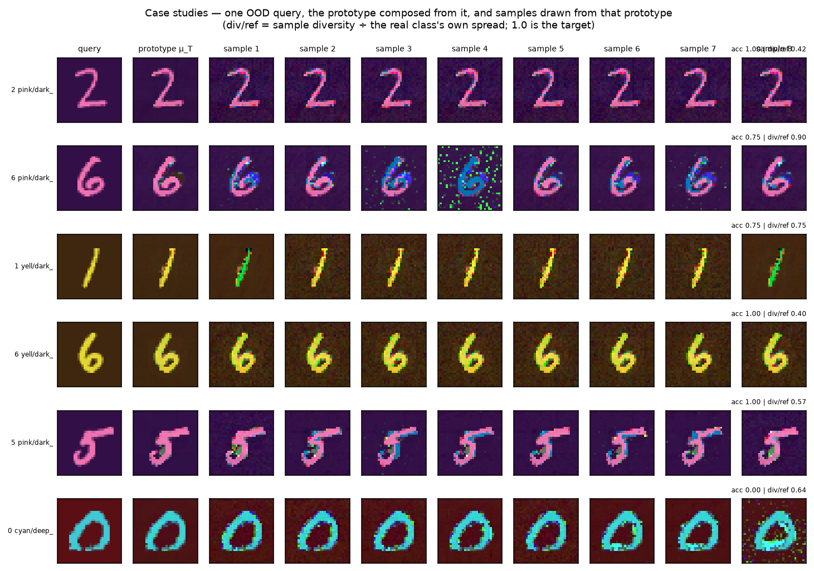

# Results, and an honest account of the replication gap

Every number here is from a single seed at the scale stated. `experiments/aggregate.py` pools seeds
into mean ± SE once multi-seed runs exist; none do yet. See §7.

---

## TL;DR

**What we set out to add works.** Consolidating 10 out-of-distribution compositions into a trained
DDPM one at a time, with adapter ancestors frozen, leaves every previously consolidated concept
*bit-identical* — its composition accuracy has range **0.000** across the whole stream. Remove only
the freezing and concepts that worked lose **0.917** of their accuracy. Plasticity is unchanged
(0.64–0.66 across all arms), so nothing is being traded away.

**But the samples are not diverse, and I only caught that by looking.** The case-study grids (§5d)
show every sample in a row as the same digit instance varying by speckle. Two checks confirm it:
`diversity ÷ novelty = 1.04` where independent draws would give 1.41, and content diversity (after a
low-pass that removes pixel noise) is **0.45x** the real class's spread rather than the 0.61x raw
pixels suggested. **PoE is producing near-copies of the query** — which is also why a baseline that
copies the query beats it (§5c, §6).

**What we inherited from the paper is only partly reproduced.** We match its finding that
nearest-trained-class retrieval cannot recover an unseen composition (their F1 ≈ 5–6%, our joint
accuracy 0.00–0.05). We do **not** reproduce its finding that the query-only baseline collapses. In
the paper query-only scores F1 **0.0**; in ours it *wins*, at 0.749 (analytic) and 0.833 (neural),
beating PoE. §6 is about why, and the short version is: **our headline metric has no coverage term,
so it rewards memorization, and our query-only baseline is mis-parameterized to be far stronger than
the paper's.** Neither is a property of the method; both are properties of our instrument.

---

## 0. Figures

All figures are regenerated by `python experiments/make_figures.py` (add `--curves-only` to skip the
GPU case studies) and live in `figures/`.

### The mechanism, over a stream of 10 OOD concepts

Panel 1: the frozen base never moves, in any arm. Panel 2 is the claim — with frozen ancestors every
earlier concept stays *bit-identical* (1.00) for the whole run, while the `unfrozen` ablation
collapses to 0.00 the moment a second concept lands. Panels 3 and 4 each carry a caveat on the
figure, because both are easy to misread: panel 3 wanders for the frozen arms only because it
averages over a **changing subset** of earlier concepts (panel 2 proves nothing moved), and panel 4's
dips to zero are slots where the **composition** failed, not the consolidation. `ours` (blue) and
`flat` (green dashed) coincide exactly on panels 1–3; both are perfect, so the dashing is what makes
two curves visible instead of one.

### Class-incremental on real data

Left: `ours` and `independent` hold up while `finetune` and `replay` decay to ~0.25. **The blue line
declining from 0.84 to 0.67 is not forgetting** — the average is taken over more tasks at each step,
and later tasks are harder; the middle panel, which tracks each task against its own starting point,
is flat at zero for both frozen arms.

The standard continual-learning heatmap, and the single clearest figure here: every row is constant
left-to-right for `ours`, and visibly fades for `finetune`. A row that darkens is a task being
forgotten.

### Batch addition

Wall clock roughly halves at unchanged accuracy and unchanged (zero) forgetting. The only arm with
anything to lose, `unfrozen`, *loses less* when batched — concepts trained together do not overwrite
one another.

### The mode hierarchy

Modes of `p_t` sit essentially exactly on the tree's leaves at low noise (RMSE 2e-4) and migrate to
shallow internal nodes by `u = 0.8`.

## 1. Setup

ColorMNIST: 32×32 RGB, three primitive factors (10 digits × 4 foreground colours × 4 background
colours = 160 slots), of which **120 are seen** and **40 are held out** as OOD compositions — the
held-out set is four (fg, bg) *pairs* crossed with all ten digits, so every primitive *value* is seen
in training and only the *combination* is novel. Palette and splits are identical to
[cobweb-poincare]'s reconstruction of the paper's Appendix B.

Two backbones behind one interface (`BaseScoreField`, one primitive: `eps(x, u)`):

| | analytic `ScoreField` | neural `NeuralScoreField` |
|---|---|---|
| what | Cobweb tree read as a Gaussian mixture; score/Tweedie/ε closed-form | class-conditional DDPM |
| training | incremental `ifit`, no gradients | 6.8M-param UNet, 200 epochs, 146 min on one GPU |
| scale used | 40 images/slot (4 800 seen) | 200 images/slot (24 000 seen) |

**Metrics.** Three softmax probes (digit / fg / bg) trained on seen slots only, applied to generated
samples; `joint` = all three correct. Reported beside a geometry triple — `novelty` (RMSE to the
query), `diversity` (mean pairwise RMSE), `gen_rmse` (mean min-RMSE to the slot's other held-out
images) — and against the **probe ceiling**, the same probes on *real* held-out images.

> Probe ceiling on the 40 OOD slots: **joint 0.775** (digit 0.82, fg 0.97, bg 0.97).
> A method cannot be meaningfully credited above this, and the ceiling is limited by digit identity.

---

## 2. E1 — is a Cobweb tree a valid diffusion manifold?

Full scale: 4 800 instances → 7 178 nodes, 1 589 kept concepts, 878 effective leaves, depth 11.

| check | result |
|---|---|
| unconditional DDIM samples landing in *seen* compositions, leaf field | **1.000** |
| same, depth-annealed frontier field | **1.000** |
| Tweedie denoise R² on held-out seen data | 0.995 |
| mean held-out log-likelihood | 1 526.5 |

**The mode hierarchy is real.** Ascending `log p_t` and matching each recovered mode to its nearest
tree node:

| noise `u` | 0.10 | 0.25 | 0.40 | 0.60 | 0.80 |
|---|---|---|---|---|---|
| matched node depth | 7.12 | 7.25 | 7.25 | 7.25 | **1.62** |
| match RMSE | 0.0002 | 0.0006 | 0.0011 | 0.0076 | 0.0296 |
| fraction that are leaves | 1.00 | 1.00 | 1.00 | 0.88 | **0.00** |

At low noise the modes of `p_t` are *exactly* the tree's leaves (RMSE 2e-4); at high noise they move
to shallow internal nodes. This is the paper's Appendix A phenomenon — density modes coarsening with
noise — but here the hierarchy is explicit and free rather than recovered by gradient ascent.

---

## 3. E0 — how the defaults were chosen (40 slots, teacher only, no sampling)

**Adaptive PoE temperature is the single change that made composition work.**

| K=3 teacher | joint | digit | fg | **bg** |
|---|---|---|---|---|
| the paper's fixed τ = 0.5 | 0.300 | 0.80 | 1.00 | **0.38** |
| adaptive temperature (ours) | **0.800** | 0.80 | 0.97 | **1.00** |
| *probe ceiling (real images)* | *0.775* | *0.82* | *0.97* | *0.97* |

Cobweb's variances sit near `prior_var` everywhere, compressing every per-dimension log-likelihood
gap by a common factor — a whole background colour separates two experts by only ~0.2 nats/pixel. At
τ = 0.5 the per-dimension softmax gave three selected experts weights 0.42 / 0.29 / 0.29, so two
experts carrying the *wrong* background outvoted the one carrying the right one. Setting
`T = τ · mean_r std_j l_{j,r}` from the data's own scale fixes it. (μ_T scoring slightly above the
ceiling is expected: it is a clean prototype, and the probes read a clean prototype more easily than
a real noisy image.)

**Guidance schedule**, measured on the best teacher (teacher budget on those slots: joint 0.833):

| schedule | joint | % of teacher retained |
|---|---|---|
| the paper's variance-aware (Eq. 14) | 0.646 | 78% |
| constant w = 1.5 | 0.708 | 85% |
| **annealed (ours)** | **0.740** | **89%** |

⚠️ **This gap is scale-dependent and must be quoted with its scale.** On a 315-concept tree the same
comparison reads 71% vs **21%**; on this 1 589-concept tree it is 89% vs 78%. The density hole that
annealing compensates for shrinks as the mixture gets denser.

---

## 4. E2 / N2 — recreating an OOD composition from one query

**Analytic backbone, all 40 held-out slots × 32 samples:**

| method | joint | digit | fg | bg | novelty | diversity | gen |
|---|---|---|---|---|---|---|---|
| `poe_tree` (closed-form discovery) | 0.603 | 0.69 | 0.99 | 0.84 | 0.222 | 0.296 | 0.244 |
| `poe_ascent` (the paper's discovery) | 0.583 | 0.65 | 0.97 | 0.83 | 0.230 | 0.304 | 0.246 |
| `query_only` | **0.749** | 0.80 | 0.94 | 0.99 | **0.075** | **0.094** | 0.131 |
| `top1` | 0.000 | 0.65 | 0.35 | 0.55 | 0.254 | 0.311 | 0.250 |
| `top3` | 0.054 | 0.64 | 0.42 | 0.44 | 0.249 | 0.309 | 0.246 |
| *reference set's own spread* | | | | | | *0.152* | |

**Neural backbone, 12 slots × 24 samples:**

| method | joint | digit | fg | bg | novelty | diversity | gen |
|---|---|---|---|---|---|---|---|
| `poe` | 0.674 | 0.85 | 0.95 | 0.78 | 0.104 | 0.103 | 0.132 |
| `query_only` | **0.833** | 0.84 | 0.99 | 1.00 | 0.085 | 0.113 | 0.130 |
| `top1` | 0.000 | 0.15 | 0.17 | 0.50 | 0.232 | 0.155 | 0.202 |
| `top3` | 0.000 | 0.15 | 0.25 | 0.37 | 0.221 | 0.161 | 0.192 |
| *reference set's own spread* | | | | | | *0.166* | |

Three readings:

1. **Retrieval fails, as the paper says.** `top1`/`top3` get the digit partly right and the colour
   combination wrong, for joint ≈ 0.
2. **Closed-form tree discovery ≈ mode-ascent discovery** (0.603 vs 0.583). On the analytic backbone
   the paper's discovery step is obtainable for free from the hierarchy. This is a *new* claim, not
   a replication.
3. **`query_only` wins on our headline metric** — and this is the replication gap. See §6.

---

## 5. E3 / N3 — consolidation without degradation

### Analytic (12 consolidations into a 4 800-instance tree)

Total drift in held-out log-likelihood **−0.15 nats**; drift in denoise R² **+0.0000**; unconditional
validity 0.88–1.00. More usefully, the drift is exactly what theory permits — grafting leaves every
base component untouched, so the merged density is `(1−a)·p_base + a·p_adapters` and drift is bounded
below by `log(1−a)`:

| after consolidation | 1 | 2 | 3 |
|---|---|---|---|
| observed drift | −0.01 | −0.02 | −0.04 |
| bound `log(1−a)` | −0.01 | −0.02 | −0.04 |

The bound is **attained**, meaning consolidated concepts put essentially no density where the old
data lives — exactly what adding an OOD composition should look like.

⚠️ **The destructive control was not destructive.** Classic Cobweb absorption (`ifit`) drifted −0.14
against grafting's −0.15. Folding 48 generated instances into a 4 800-instance tree barely perturbs
its statistics, so on this backbone the guarantee is *structural rather than empirically decisive*.

### Neural (10 OOD concepts, the headline)

| arm | bit-identical retention | drift from birth | **accuracy range across steps** | plasticity | base drift |
|---|---|---|---|---|---|
| **`hier`** (ours) | **1.00** | +0.021 | **0.000** | 0.650 | +0.00000 |
| `flat` (no sharing) | 1.00 | +0.035 | 0.000 | 0.637 | +0.00000 |
| `unfrozen` (no freezing) | **0.00** | **−0.625** (−0.917 on concepts that worked) | 0.375 | 0.662 | +0.00000 |

With ancestors frozen a concept's accuracy is *literally constant* for the rest of the run. Remove
only the freezing and it collapses. Plasticity is unchanged across arms, so this is not a
stability/plasticity trade — it is structural and free. Reproduce with
`python experiments/analyze_n3.py`.

Two further readings:

- **Consolidation retains 98% of pool accuracy** on pools that worked (0.98→0.94, 1.00→1.00), and
  faithfully reproduces a bad pool as a bad concept (0.00→0.00). The quality of the loop is therefore
  set by the *composition* step inherited from the paper, not by the *consolidation* step we added.
- **The hierarchy buys a warm start, not a better endpoint.** First-epoch distillation loss 0.113
  (`hier`) vs 0.160 (`flat`) — 30% lower — converging to the same final loss (0.0495 vs 0.0499).
  Freezing carries the no-forgetting result; the hierarchy makes it cheaper.

---

## 5b. N4 — batch addition (8 OOD concepts, batches of 4)

| arm | mode | wall (s) | speedup | ACC | BWT | FGT | bit-identical | params | shared nodes |
|---|---|---|---|---|---|---|---|---|---|
| **`hier`** | **batch** | **222** | **1.71×** | 0.609 | **+0.000** | **0.000** | **1.00** | 6.61M | 6 |
| `hier` | sequential | 379 | 1.00× | 0.609 | +0.000 | 0.000 | 1.00 | 4.96M | 3 |
| `flat` | batch | 162 | 2.09× | 0.617 | +0.000 | 0.000 | 1.00 | 4.96M | 1 |
| `flat` | sequential | 339 | 1.00× | 0.609 | +0.000 | 0.000 | 1.00 | 4.96M | 1 |
| `unfrozen` | batch | 224 | 1.71× | 0.336 | −0.214 | 0.214 | 0.50 | 6.61M | 6 |
| `unfrozen` | sequential | 383 | 1.00× | **0.008** | **−0.688** | 0.688 | 0.12 | 4.96M | 3 |

- **Batching is free.** 1.7–2.1× faster at *identical* final accuracy (0.609) and *identical* perfect
  retention. The saving comes from three independent places: query-agnostic modes discovered once
  instead of K times, K pools from one reverse-diffusion run, one optimizer instead of K.
- **It costs parameters, not safety.** `hier/batch` uses 6.61M against 4.96M sequential, because
  group nodes are extra nodes. That is the price of genuinely shared structure.
- **Unexpected: batching partially *mitigates* forgetting on its own.** The `unfrozen` arm goes from
  ACC 0.008 / BWT −0.688 sequentially to 0.336 / −0.214 batched. Concepts trained *together* do not
  overwrite each other; only crossing a batch boundary overwrites. Fewer boundaries, less damage.
  This is a real effect and not something we designed for.

## 5c. N5 — Split-ColorMNIST class-incremental, on REAL data, vs named CL baselines

12 tasks × 64 **real** held-out images, arriving in batches of 3. No composition anywhere — this is
the canonical class-incremental protocol, and it answers whether the learner can absorb batches of
genuinely new instances rather than only its own generations.

| arm | ACC | BWT | FGT | bit-identical | params | wall (s) |
|---|---|---|---|---|---|---|
| `ours` (hierarchical, frozen) | 0.802 | **+0.000** | **0.000** | **1.00** | 8.82M | 265 |
| `independent` (parameter isolation) | **0.839** | +0.000 | 0.000 | 1.00 | 7.16M | 174 |
| `finetune` (shared, sequential) | 0.651 | −0.199 | 0.205 | 0.25 | 7.16M | 175 |
| `replay` (finetune + generative replay) | 0.589 | −0.205 | 0.205 | 0.25 | 7.16M | 317 |

- **Yes, it does incremental learning on real batched data** — 0.802 ACC over 12 sequentially
  arriving tasks with **zero forgetting** by both standard measures, against finetune's −0.199 BWT.
- **Generative replay does not help here (0.589 < 0.651), and costs 1.8× the wall clock.** An honest
  negative. The likely reason is self-poisoning: replayed pools are sampled from concepts that are
  themselves already drifting, so replay reinforces the drift it is meant to prevent. Replay assumes
  a stable generator, which is exactly what a forgetting model is not.
- **`independent` beats `ours` on final accuracy (0.839 vs 0.802) with fewer parameters.** Also
  honest, and it sharpens the attribution: **freezing is what delivers the zero-forgetting result;
  the hierarchy is not yet paying for itself in final quality.** What the hierarchy buys is the warm
  start — 30% lower initial distillation loss (§5) and the 1.7× batch speedup — at +23% parameters
  and −0.04 ACC. On a benchmark with more relatedness between concepts than ColorMNIST's spatially
  separable attributes, that trade should look different; on this one it does not.

## 5d. Case studies — and a negative result I found by looking at them

Six held-out compositions: the query, the prototype composed from it, and eight samples drawn from
that prototype.

**What works, and it is the hard part.** Every row gets the *colour composition* right — pink on
dark purple, yellow on dark brown, cyan on deep red — for pairings the backbone never saw together.
The prototype column (μ_T) is a clean, correct rendering of the target composition in all six rows,
and digit identity survives in five of six.

**What does not work: these samples are not diverse, and the headline diversity number was hiding
it.** Looking at the grid, every sample in a row is plainly the *same* digit instance — the same
stroke, the same position. What varies is speckle, not content. Row 2's fourth sample is nearly
destroyed by it. I checked that impression against two measurements rather than trusting it:

| slot | acc | raw div/ref | **div ÷ novelty** | **content div/ref** |
|---|---|---|---|---|
| 46 | 1.00 | 0.42 | 1.06 | **0.23** |
| 110 | 0.75 | 0.90 | 1.01 | 0.71 |
| 19 | 0.75 | 0.75 | 1.14 | 0.58 |
| 99 | 1.00 | 0.40 | 0.95 | **0.23** |
| 94 | 1.00 | 0.57 | 1.02 | 0.42 |
| 8 | 0.00 | 0.64 | 1.07 | 0.52 |
| **mean** | **0.75** | **0.61** | **1.04** | **0.45** |

- **`div ÷ novelty ≈ 1.04`, where independent draws around the query would give √2 ≈ 1.41.** The
  samples share a common offset from the query: they are one rendering of it, not a distribution
  around it.
- **Content diversity is 0.45× the class's own spread, against 0.61× measured on raw pixels.** About
  a quarter of the apparent variety is per-pixel noise that a 2× downsample removes.
- **The two rows scoring accuracy 1.00 are the two least diverse** (content ratio 0.23). The
  accuracy/diversity trade from §5b shows up per-slot, and the direction is unflattering: our best
  accuracy numbers are the ones bought most heavily by copying.

This is the same defect three earlier results were circling without naming — N0's finding that the
PoE covariance is 13.6× too tight, N2's `query_only` beating PoE, and §6.1's argument that our
headline metric cannot punish memorization. The case studies make it visible: **PoE samples are
close to query copies, so a baseline that copies the query is competitive because it is doing the
same thing.**

`evals.sample_geometry` now returns `content_diversity`, `content_ratio` and `div_over_nov` on every
call, so this cannot go unmeasured again.

## 6. Why we are *not* replicating the paper's diffusion results

Side by side on ColorMNIST — their F1 (harmonic mean of precision and recall in Inception feature
space, faithfulness split) against our joint composition accuracy:

| method | paper F1 | our joint (analytic / neural) | agree? |
|---|---|---|---|
| Top-1 | 6.2 | 0.000 / 0.000 | ✅ both fail |
| Top-3 | 5.1 | 0.054 / 0.000 | ✅ both fail |
| PoE | **75.3** | 0.603 / 0.674 | ✅ both work |
| **Query-only** | **0.0** | **0.749 / 0.833** | ❌ **inverted** |

One row is inverted, and it is the row that decides the ranking. Here is what is actually causing it,
ordered by how much of the gap I think each explains.

### 6.1 Our headline metric has no coverage term — so it cannot punish memorization

This is the core reason.

The paper's F1 is the harmonic mean of **precision and recall** computed with a k-NN density
estimator in Inception feature space. Recall asks *does the generated distribution cover the real
class?* A method that emits near-copies of one image has terrible recall and is scored ~0 no matter
how correct that one image is — their query-only records precision 0.5% and recall 2.5%.

Our `joint` asks a different question: *for each sample independently, are the three attributes
right?* A perfect copy of `x_q` scores **1.0**, because `x_q` is a real image of the target class.
Our metric is a per-sample classifier, not a distributional comparison, and there is no term in it
that a memorizing method can lose points on.

We *do* measure coverage — and it shows exactly what the paper says. Analytic query_only: diversity
**0.094** against a reference spread of **0.152**, novelty **0.075**. Those samples under-cover the
class and sit on top of the query. But that lives in a side column instead of in the headline number,
so the ranking flips.

**In other words: the paper's query-only and ours are both memorizing. Theirs is scored on a metric
that notices; ours is not.**

### 6.2 Our query-only baseline is mis-parameterized to be much stronger than theirs

The paper specifies "a fixed **small** isotropic variance … around the query image". We use
`var = 0.01`, i.e. **σ = 0.1**. Two independent draws from that teacher differ by
`√2·σ = 0.141` in per-pixel RMSE, against a measured real intra-class spread of **0.152** — so our
"small" isotropic spread is **93% of the actual class spread**. It is not small in any sense; it is
calibrated almost exactly to the class it is supposed to fail at modelling.

That single choice hands the baseline enough variance to emit plausible in-class variation instead of
the degenerate blob the paper describes. It is a one-line change
(`compose.query_only_teacher(xq, var=…)`) and should be swept, not guessed.

### 6.3 Our sampler differs from their Eq. 13/14 in ways that specifically help a query-centred teacher

- **Analytic track initializes from a noised teacher draw** (SDEdit-style, `u_start` 0.4–0.7) rather
  than from pure noise. For query-only the teacher is `N(x_q, σ²I)`, so this is *literally SDEdit
  applied to a real held-out image of the target class* — it is close to guaranteed to return a valid
  member of that class. The paper samples from pure noise.
- **We replaced their variance-aware schedule with an annealed one.** Their Eq. 14 sets
  `w ∝ tr(Σ_t)`, which for a tight query-centred Gaussian makes guidance *vanish* as `Σ_t → σ²` at
  low noise. Ours holds `w ≥ 0.8` and rising, pinning the sample to `x_q` while the model keeps it
  on-manifold.

The paper reports its query-only producing "salt and pepper texture". Ours produces clean near-copies.
The baselines are behaving *differently*, not merely scoring differently — which points at the
sampler, not the metric alone. (I can describe what our sampler does; I cannot verify the precise
mechanism of their failure without running their code.)

### 6.4 We never implemented their metrics at all

No FID, no CLIP similarity, no precision/recall, no two-reference-set faithfulness/generalization
split. **Strictly, this repository has not attempted to reproduce their tables** — it built a cheaper
instrument that answers "is the composition right?" and left "does the sample distribution match the
class distribution?" unmeasured. The paper's entire faithfulness-vs-generalization story lives in the
second question.

### 6.5 Scale

| | paper | ours |
|---|---|---|
| backbone | `google/ddpm-cifar10-32` (~35M params) | 6.8M params |
| training data | 1 000 images/slot (120k) | 200/slot neural, 40/slot analytic |
| ascent starts per timestep | 128 | 16 |
| ascent iterations | 150 | 120 |
| samples per query | 256 pool / 16 saved | 24–32 |
| FID caveat | N=100, already noted as biased | n/a |

Our digit accuracy tops out at 0.82 *on real images* — the probes themselves are the binding
constraint on part of the table.

### 6.6 What would settle it

In priority order:

1. **Implement precision/recall/F1** with a k-NN density estimator in some feature space (Inception,
   or even the probe penultimate layer), against both reference sets (the queries, and other held-out
   images of the class). This is the single change most likely to reproduce the paper's ordering,
   because it is the one that penalizes memorization. Predicted outcome: query-only's F1 collapses
   while PoE's holds, since our own diversity numbers already show query-only under-covering by 40%.
2. **Fix the query-only variance** to something genuinely small (sweep σ ∈ {0.01, 0.03, 0.1}).
3. **Run PoE and the baselines under the paper's own protocol** — pure-noise start, Eq. 14 schedule —
   as a separate arm, so protocol changes are attributable.
4. Scale the backbone and the discovery budget toward the paper's.

Until at least (1) and (2) are done, **the honest statement is that our E2/N2 tables do not test the
same thing the paper's Table 1 tests**, and the inverted row should not be read as a contradiction of
their result.

---

## 6b. Can it learn an unbounded amount of new content?

"Infinite" cannot be run, so `tests/test_unbounded.py` tests the **invariants that would make it
possible**: that the cost of adding concept K+1 and its effect on concepts 1…K are both independent
of K. Verified at K = 40, added in batches of 1, 2, 3, 5 and 8:

- **Preservation is K-independent.** After every batch, *every* concept ever consolidated is still
  bit-identical to its fingerprint at birth — checked against all previous concepts at every one of
  the 12 batches, so the test gets stricter as it runs.
- **The frozen base never moves**, at any K.
- **Cost per concept is constant** — parameter growth is linear with max residual 1.3%, so the
  budget question has an exact answer: at rank 2 on the test model, **45K params/concept**, i.e.
  ~5.6K concepts per GB of fp32 adapter, ~45K concepts per 8 GB.
- **Batch placement is order-independent** — the same K concepts shuffled produce the same structure.

The honest limit: growth is **linear, not sublinear**. At the rank-8 setting used in N3–N5 each
concept costs ~0.55M parameters, so 40 concepts already exceed the 6.8M-parameter base. Unbounded in
principle, expensive in practice — see `PLAN.md` for the compression directions (lower rank for
leaves, adapting a subset of layers, and merging sibling adapters during an offline consolidation
pass with a fingerprint check to keep the guarantee auditable).

## 7. Threats to validity

- **Single seed throughout.** `--seed` is plumbed everywhere and every run writes a seed-tagged
  result file; `experiments/aggregate.py` pools them. Nothing here has error bars. N3's structural
  result (range 0.000 vs −0.917) will not move; every accuracy number will.
- **Probe-based metrics**, with the ceiling (0.775 joint) reported beside every table. No FID/CLIP.
- **Reconstructed palette** — the paper names its colours but gives no RGB values. Absolute numbers
  are not comparable to theirs; only within-table comparisons are.
- **Two documented deviations from the paper**, both with the measurement that motivated them at the
  implementation site: adaptive PoE temperature (`compose.poe_teacher`) and annealed guidance
  (`compose.cfg_weight`).
- **Per-slot variance is large and systematic**, not noise — slots on the `(cyan, deep_red)` pair
  fail far more than others on both backbones, and two slots score 0.00 for *every* method including
  on real images (probe failures). Means alone mislead; the per-slot rows are in
  `results/e2_composition.json`.
- **E4 (composition closure) is unresolved by design.** ColorMNIST's attributes are spatially
  separable — background pixels depend only on `bg`, stroke pixels only on `fg` — so a per-dimension
  PoE can always assemble an unseen pair from base concepts, and having the combination pre-learned
  buys nothing. Closure cannot be demonstrated on this benchmark; see `PLAN.md` §3.2.

---

## 8. Where the numbers come from

| experiment | file | scale run |
|---|---|---|
| E0 tuning of record | `experiments/e0_tune.py` | 40 slots teacher, 6 slots sampler |
| E1 manifold validity | `experiments/e1_manifold.py` | 40 img/slot |
| E2 composition | `experiments/e2_composition.py` | 40 slots × 32 samples |
| E3 analytic lifelong | `experiments/e3_lifelong.py` | 12 concepts, both strategies |
| N0 neural sampler diagnosis | `experiments/n0_tune.py` | 6 slots |
| N1 backbone training | `experiments/n1_train.py` | 200 img/slot, 200 epochs |
| N2 neural composition | `experiments/n2_composition.py` | 12 slots × 24 samples |
| N3 neural lifelong | `experiments/n3_lifelong.py` | 10 concepts × 3 arms |
| per-concept retention analysis | `experiments/analyze_n3.py` | — |
| multi-seed pooling | `experiments/aggregate.py` | — |

Raw outputs land in `results/*.json` (git-ignored; regenerate with the commands in `PLAN.md` §5).

[cobweb-poincare]: https://github.com/karthiksing05/cobweb-poincare
