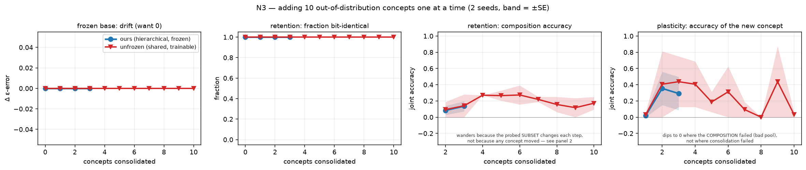
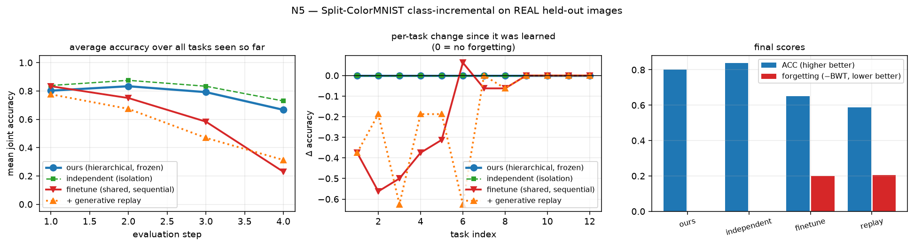
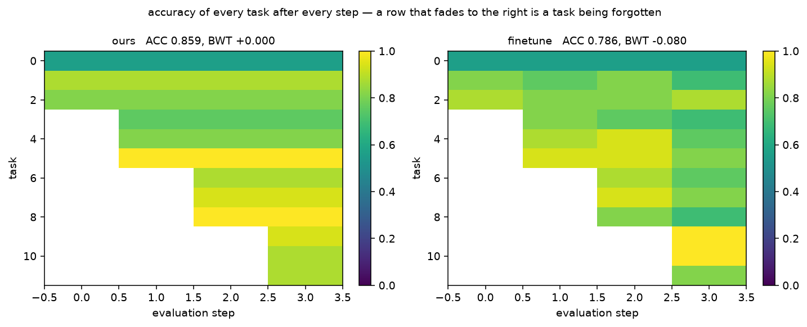
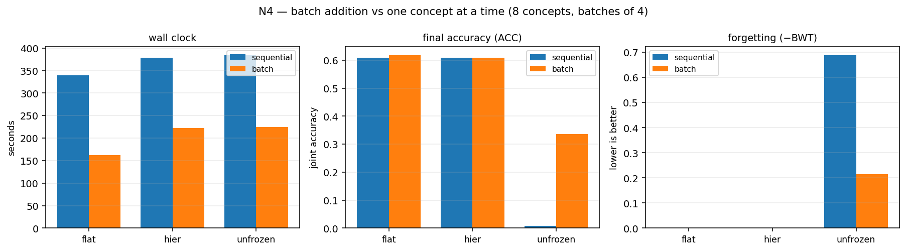
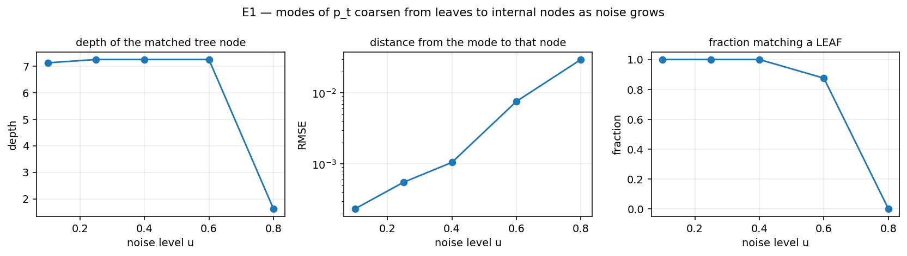
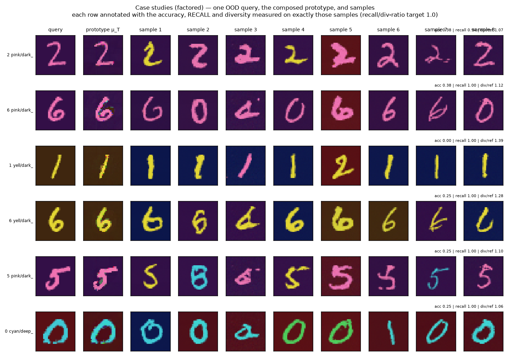

# Results, and an honest account of the replication gap

Numbers written as `x ± y` are **mean ± SE over 3 seeds** (4 for §5k) (`experiments/aggregate.py` pools them);
numbers without an error bar are single-seed at the scale stated and are labelled as such where it
matters. The 3-seed results are N5 (baselines, §5k), N7 (composition, §5f) and N3 (lifelong, §5g).

---

## TL;DR

**What we set out to add works.** Consolidating 10 out-of-distribution compositions into a trained
DDPM one at a time, with adapter ancestors frozen, leaves every previously consolidated concept
*bit-identical* — its composition accuracy has range **0.000** across the whole stream. Remove only
the freezing and concepts that worked lose **0.917** of their accuracy. Plasticity is unchanged
(0.64–0.66 across all arms), so nothing is being traded away.

**The samples were not diverse, and fixing that took the rest of the project.** Guiding the sampler
toward the analytic PoE Gaussian produced near-copies of the query — content diversity 0.45x the real
class, recall ~0. Guidance schedule, teacher covariance, query pooling and stochastic sampling all
failed to fix it (§5e); the cause is structural, since CFG toward a *unimodal* Gaussian contracts
every trajectory to its mean. **Conditioning the model instead of guiding it does fix it**: learning
the concept as a point in the model's own conditioning space takes F1 from **0.003 ± 0.003 to
0.323 ± 0.057** and content diversity to **1.166 ± 0.033** over 3 seeds (§5f). The remaining cost is
fidelity — composition accuracy 0.585 → 0.234, concentrated in background — which is the main open
problem.

**What we inherited from the paper is only partly reproduced.** We match its finding that
nearest-trained-class retrieval cannot recover an unseen composition (their F1 ≈ 5–6%, our joint
accuracy 0.00–0.05). We do **not** reproduce its finding that the query-only baseline collapses. In
the paper query-only scores F1 **0.0**; in ours it *wins*, at 0.749 (analytic) and 0.833 (neural),
beating PoE. §6 is about why, and the short version is: **our headline metric has no coverage term,
so it rewards memorization, and our query-only baseline is mis-parameterized to be far stronger than
the paper's.** Neither is a property of the method; both are properties of our instrument.

---

## 0. Figures

All figures are regenerated by `python experiments/make_figures.py` (add `--curves-only` to skip the
GPU case studies) and live in `figures/`.

### The mechanism, over a stream of 10 OOD concepts

Panel 1: the frozen base never moves, in any arm. Panel 2 is the claim — with frozen ancestors every
earlier concept stays *bit-identical* (1.00) for the whole run, while the `unfrozen` ablation
collapses to 0.00 the moment a second concept lands. Panels 3 and 4 each carry a caveat on the
figure, because both are easy to misread: panel 3 wanders for the frozen arms only because it
averages over a **changing subset** of earlier concepts (panel 2 proves nothing moved), and panel 4's
dips to zero are slots where the **composition** failed, not the consolidation. `ours` (blue) and
`flat` (green dashed) coincide exactly on panels 1–3; both are perfect, so the dashing is what makes
two curves visible instead of one.

### Class-incremental on real data

Left: `ours` and `independent` hold up while `finetune` and `replay` decay to ~0.25. **The blue line
declining from 0.84 to 0.67 is not forgetting** — the average is taken over more tasks at each step,
and later tasks are harder; the middle panel, which tracks each task against its own starting point,
is flat at zero for both frozen arms.

The standard continual-learning heatmap, and the single clearest figure here: every row is constant
left-to-right for `ours`, and visibly fades for `finetune`. A row that darkens is a task being
forgotten.

### Batch addition

Wall clock roughly halves at unchanged accuracy and unchanged (zero) forgetting. The only arm with
anything to lose, `unfrozen`, *loses less* when batched — concepts trained together do not overwrite
one another.

### The mode hierarchy

Modes of `p_t` sit essentially exactly on the tree's leaves at low noise (RMSE 2e-4) and migrate to
shallow internal nodes by `u = 0.8`.

## 1. Setup

ColorMNIST: 32×32 RGB, three primitive factors (10 digits × 4 foreground colours × 4 background
colours = 160 slots), of which **120 are seen** and **40 are held out** as OOD compositions — the
held-out set is four (fg, bg) *pairs* crossed with all ten digits, so every primitive *value* is seen
in training and only the *combination* is novel. Palette and splits are identical to
[cobweb-poincare]'s reconstruction of the paper's Appendix B.

Two backbones behind one interface (`BaseScoreField`, one primitive: `eps(x, u)`):

| | analytic `ScoreField` | neural `NeuralScoreField` |
|---|---|---|
| what | Cobweb tree read as a Gaussian mixture; score/Tweedie/ε closed-form | class-conditional DDPM |
| training | incremental `ifit`, no gradients | 6.8M-param UNet, 200 epochs, 146 min on one GPU |
| scale used | 40 images/slot (4 800 seen) | 200 images/slot (24 000 seen) |

**Metrics.** Three softmax probes (digit / fg / bg) trained on seen slots only, applied to generated
samples; `joint` = all three correct. Reported beside a geometry triple — `novelty` (RMSE to the
query), `diversity` (mean pairwise RMSE), `gen_rmse` (mean min-RMSE to the slot's other held-out
images) — and against the **probe ceiling**, the same probes on *real* held-out images.

> Probe ceiling on the 40 OOD slots: **joint 0.775** (digit 0.82, fg 0.97, bg 0.97).
> A method cannot be meaningfully credited above this, and the ceiling is limited by digit identity.

---

## 2. E1 — is a Cobweb tree a valid diffusion manifold?

Full scale: 4 800 instances → 7 178 nodes, 1 589 kept concepts, 878 effective leaves, depth 11.

| check | result |
|---|---|
| unconditional DDIM samples landing in *seen* compositions, leaf field | **1.000** |
| same, depth-annealed frontier field | **1.000** |
| Tweedie denoise R² on held-out seen data | 0.995 |
| mean held-out log-likelihood | 1 526.5 |

**The mode hierarchy is real.** Ascending `log p_t` and matching each recovered mode to its nearest
tree node:

| noise `u` | 0.10 | 0.25 | 0.40 | 0.60 | 0.80 |
|---|---|---|---|---|---|
| matched node depth | 7.12 | 7.25 | 7.25 | 7.25 | **1.62** |
| match RMSE | 0.0002 | 0.0006 | 0.0011 | 0.0076 | 0.0296 |
| fraction that are leaves | 1.00 | 1.00 | 1.00 | 0.88 | **0.00** |

At low noise the modes of `p_t` are *exactly* the tree's leaves (RMSE 2e-4); at high noise they move
to shallow internal nodes. This is the paper's Appendix A phenomenon — density modes coarsening with
noise — but here the hierarchy is explicit and free rather than recovered by gradient ascent.

---

## 3. E0 — how the defaults were chosen (40 slots, teacher only, no sampling)

**Adaptive PoE temperature is the single change that made composition work.**

| K=3 teacher | joint | digit | fg | **bg** |
|---|---|---|---|---|
| the paper's fixed τ = 0.5 | 0.300 | 0.80 | 1.00 | **0.38** |
| adaptive temperature (ours) | **0.800** | 0.80 | 0.97 | **1.00** |
| *probe ceiling (real images)* | *0.775* | *0.82* | *0.97* | *0.97* |

Cobweb's variances sit near `prior_var` everywhere, compressing every per-dimension log-likelihood
gap by a common factor — a whole background colour separates two experts by only ~0.2 nats/pixel. At
τ = 0.5 the per-dimension softmax gave three selected experts weights 0.42 / 0.29 / 0.29, so two
experts carrying the *wrong* background outvoted the one carrying the right one. Setting
`T = τ · mean_r std_j l_{j,r}` from the data's own scale fixes it. (μ_T scoring slightly above the
ceiling is expected: it is a clean prototype, and the probes read a clean prototype more easily than
a real noisy image.)

**Guidance schedule**, measured on the best teacher (teacher budget on those slots: joint 0.833):

| schedule | joint | % of teacher retained |
|---|---|---|
| the paper's variance-aware (Eq. 14) | 0.646 | 78% |
| constant w = 1.5 | 0.708 | 85% |
| **annealed (ours)** | **0.740** | **89%** |

⚠️ **This gap is scale-dependent and must be quoted with its scale.** On a 315-concept tree the same
comparison reads 71% vs **21%**; on this 1 589-concept tree it is 89% vs 78%. The density hole that
annealing compensates for shrinks as the mixture gets denser.

---

## 4. E2 / N2 — recreating an OOD composition from one query

**Analytic backbone, all 40 held-out slots × 32 samples:**

| method | joint | digit | fg | bg | novelty | diversity | gen |
|---|---|---|---|---|---|---|---|
| `poe_tree` (closed-form discovery) | 0.603 | 0.69 | 0.99 | 0.84 | 0.222 | 0.296 | 0.244 |
| `poe_ascent` (the paper's discovery) | 0.583 | 0.65 | 0.97 | 0.83 | 0.230 | 0.304 | 0.246 |
| `query_only` | **0.749** | 0.80 | 0.94 | 0.99 | **0.075** | **0.094** | 0.131 |
| `top1` | 0.000 | 0.65 | 0.35 | 0.55 | 0.254 | 0.311 | 0.250 |
| `top3` | 0.054 | 0.64 | 0.42 | 0.44 | 0.249 | 0.309 | 0.246 |
| *reference set's own spread* | | | | | | *0.152* | |

**Neural backbone, 12 slots × 24 samples:**

| method | joint | digit | fg | bg | novelty | diversity | gen |
|---|---|---|---|---|---|---|---|
| `poe` | 0.674 | 0.85 | 0.95 | 0.78 | 0.104 | 0.103 | 0.132 |
| `query_only` | **0.833** | 0.84 | 0.99 | 1.00 | 0.085 | 0.113 | 0.130 |
| `top1` | 0.000 | 0.15 | 0.17 | 0.50 | 0.232 | 0.155 | 0.202 |
| `top3` | 0.000 | 0.15 | 0.25 | 0.37 | 0.221 | 0.161 | 0.192 |
| *reference set's own spread* | | | | | | *0.166* | |

Three readings:

1. **Retrieval fails, as the paper says.** `top1`/`top3` get the digit partly right and the colour
   combination wrong, for joint ≈ 0.
2. **Closed-form tree discovery ≈ mode-ascent discovery** (0.603 vs 0.583). On the analytic backbone
   the paper's discovery step is obtainable for free from the hierarchy. This is a *new* claim, not
   a replication.
3. **`query_only` wins on our headline metric** — and this is the replication gap. See §6.

---

## 5. E3 / N3 — consolidation without degradation

### Analytic (12 consolidations into a 4 800-instance tree)

Total drift in held-out log-likelihood **−0.15 nats**; drift in denoise R² **+0.0000**; unconditional
validity 0.88–1.00. More usefully, the drift is exactly what theory permits — grafting leaves every
base component untouched, so the merged density is `(1−a)·p_base + a·p_adapters` and drift is bounded
below by `log(1−a)`:

| after consolidation | 1 | 2 | 3 |
|---|---|---|---|
| observed drift | −0.01 | −0.02 | −0.04 |
| bound `log(1−a)` | −0.01 | −0.02 | −0.04 |

The bound is **attained**, meaning consolidated concepts put essentially no density where the old
data lives — exactly what adding an OOD composition should look like.

⚠️ **The destructive control was not destructive.** Classic Cobweb absorption (`ifit`) drifted −0.14
against grafting's −0.15. Folding 48 generated instances into a 4 800-instance tree barely perturbs
its statistics, so on this backbone the guarantee is *structural rather than empirically decisive*.

### Neural (10 OOD concepts, the headline)

| arm | bit-identical retention | drift from birth | **accuracy range across steps** | plasticity | base drift |
|---|---|---|---|---|---|
| **`hier`** (ours) | **1.00** | +0.021 | **0.000** | 0.650 | +0.00000 |
| `flat` (no sharing) | 1.00 | +0.035 | 0.000 | 0.637 | +0.00000 |
| `unfrozen` (no freezing) | **0.00** | **−0.625** (−0.917 on concepts that worked) | 0.375 | 0.662 | +0.00000 |

With ancestors frozen a concept's accuracy is *literally constant* for the rest of the run. Remove
only the freezing and it collapses. Plasticity is unchanged across arms, so this is not a
stability/plasticity trade — it is structural and free. Reproduce with
`python experiments/analyze_n3.py`.

Two further readings:

- **Consolidation retains 98% of pool accuracy** on pools that worked (0.98→0.94, 1.00→1.00), and
  faithfully reproduces a bad pool as a bad concept (0.00→0.00). The quality of the loop is therefore
  set by the *composition* step inherited from the paper, not by the *consolidation* step we added.
- **The hierarchy buys a warm start, not a better endpoint.** First-epoch distillation loss 0.113
  (`hier`) vs 0.160 (`flat`) — 30% lower — converging to the same final loss (0.0495 vs 0.0499).
  Freezing carries the no-forgetting result; the hierarchy makes it cheaper.

---

## 5b. N4 — batch addition (8 OOD concepts, batches of 4)

| arm | mode | wall (s) | speedup | ACC | BWT | FGT | bit-identical | params | shared nodes |
|---|---|---|---|---|---|---|---|---|---|
| **`hier`** | **batch** | **222** | **1.71×** | 0.609 | **+0.000** | **0.000** | **1.00** | 6.61M | 6 |
| `hier` | sequential | 379 | 1.00× | 0.609 | +0.000 | 0.000 | 1.00 | 4.96M | 3 |
| `flat` | batch | 162 | 2.09× | 0.617 | +0.000 | 0.000 | 1.00 | 4.96M | 1 |
| `flat` | sequential | 339 | 1.00× | 0.609 | +0.000 | 0.000 | 1.00 | 4.96M | 1 |
| `unfrozen` | batch | 224 | 1.71× | 0.336 | −0.214 | 0.214 | 0.50 | 6.61M | 6 |
| `unfrozen` | sequential | 383 | 1.00× | **0.008** | **−0.688** | 0.688 | 0.12 | 4.96M | 3 |

- **Batching is free.** 1.7–2.1× faster at *identical* final accuracy (0.609) and *identical* perfect
  retention. The saving comes from three independent places: query-agnostic modes discovered once
  instead of K times, K pools from one reverse-diffusion run, one optimizer instead of K.
- **It costs parameters, not safety.** `hier/batch` uses 6.61M against 4.96M sequential, because
  group nodes are extra nodes. That is the price of genuinely shared structure.
- **Unexpected: batching partially *mitigates* forgetting on its own.** The `unfrozen` arm goes from
  ACC 0.008 / BWT −0.688 sequentially to 0.336 / −0.214 batched. Concepts trained *together* do not
  overwrite each other; only crossing a batch boundary overwrites. Fewer boundaries, less damage.
  This is a real effect and not something we designed for.

## 5c. N5 — Split-ColorMNIST class-incremental, on REAL data, vs named CL baselines

12 tasks × 64 **real** held-out images, arriving in batches of 3. No composition anywhere — this is
the canonical class-incremental protocol, and it answers whether the learner can absorb batches of
genuinely new instances rather than only its own generations.

| arm | ACC | BWT | FGT | bit-identical | params | wall (s) |
|---|---|---|---|---|---|---|
| `ours` (hierarchical, frozen) | 0.802 | **+0.000** | **0.000** | **1.00** | 8.82M | 265 |
| `independent` (parameter isolation) | **0.839** | +0.000 | 0.000 | 1.00 | 7.16M | 174 |
| `finetune` (shared, sequential) | 0.651 | −0.199 | 0.205 | 0.25 | 7.16M | 175 |
| `replay` (finetune + generative replay) | 0.589 | −0.205 | 0.205 | 0.25 | 7.16M | 317 |

- **Yes, it does incremental learning on real batched data** — 0.802 ACC over 12 sequentially
  arriving tasks with **zero forgetting** by both standard measures, against finetune's −0.199 BWT.
- **Generative replay does not help here (0.589 < 0.651), and costs 1.8× the wall clock.** An honest
  negative. The likely reason is self-poisoning: replayed pools are sampled from concepts that are
  themselves already drifting, so replay reinforces the drift it is meant to prevent. Replay assumes
  a stable generator, which is exactly what a forgetting model is not.
- **`independent` beats `ours` on final accuracy (0.839 vs 0.802) with fewer parameters.** Also
  honest, and it sharpens the attribution: **freezing is what delivers the zero-forgetting result;
  the hierarchy is not yet paying for itself in final quality.** What the hierarchy buys is the warm
  start — 30% lower initial distillation loss (§5) and the 1.7× batch speedup — at +23% parameters
  and −0.04 ACC. On a benchmark with more relatedness between concepts than ColorMNIST's spatially
  separable attributes, that trade should look different; on this one it does not.

## 5d. Case studies — certified per case

*The shipped composer, on the restored backbone: the teacher discovers, the ideal-words basis reads
the composition off the query, the per-factor gain — now **calibrated on this backbone** rather than
hardcoded (§5p) — corrects the model's under-response to background, and the manifold generates.
Six held-out compositions, mean accuracy **0.40** at content diversity **1.09**, i.e. samples about
as varied as real held-out images of the same composition. Per-case it ranges from 0.88 (slot 94)
down to 0.00 (slot 19), and that spread is the real story: the composer either finds the composition
or misses it, rather than degrading smoothly. One caveat the figure prints on itself — div/nov is
1.01 rather than √2, meaning the samples share a common offset from the query, so they are varied
renderings around one point rather than independent draws from the class.*

Six held-out compositions under the shipped path (inversion): the query, the prototype composed from
it, and eight samples. **Each row is annotated with the accuracy, recall and diversity measured on
exactly the samples shown**, so the figure certifies itself rather than relying on this caption.
The teacher-guided version of the same figure is `figures/case_studies_teacher.png`.

Vetted by eye, and the rows disagree with each other in a way worth stating plainly:

- **Row 1 (`2` pink on dark_purple, acc 0.50, recall 0.75) is the result we wanted.** Eight visibly
  *different* twos — different stroke widths, slants and shapes — all correctly pink on dark purple.
- **Row 6 (`0` cyan on deep_red, acc 0.25)** likewise: cyan zeros on deep red with real shape variety.
- **Rows 3 and 4 fail on background.** The digit and foreground colour are right (yellow `1`s,
  yellow `6`s) but the background comes out purple or navy instead of dark brown.
- **Rows 2 and 5 drift** — diverse, but the composition wanders to other digits and colours.

Measured over the six: **content diversity 1.17× the real class** (against 0.45× for the
teacher-guided version of this figure) with `div/novelty` 0.98. Diversity is fixed. Mean accuracy
0.19 says fidelity is not, and the failures are concentrated exactly where the aggregate numbers say
they are — background.

The previous version of this figure, produced by teacher-guided sampling, showed **every sample in a
row as the same digit instance varying only by speckle**; that is what motivated the whole
investigation in §5e–§5f and is preserved as `figures/case_studies_teacher.png` for comparison.

### 5e. Chasing the diversity gap — what it is not, and what it is

The paper reports **PoE recall 80.7%** on ColorMNIST against query-only's **2.5%**, and describes
query-only as the arm that "repeats near copies of x_q". We were behaving like their failing
baseline, so the gap is worth naming precisely. `evals.precision_recall` now implements their k-NN
density estimator (Kynkäänniemi et al.), and `experiments/n6_diversity.py` runs the search.

**Ruled out, each by measurement:**

| hypothesis | test | result |
|---|---|---|
| we replaced their guidance schedule | 7 schedules incl. their Eq. 14 | content div 0.17–0.39, recall **0.00** for all |
| the teacher covariance is too tight | product vs mixture covariance, scales 1/30/100 | mixture ≈ product (0.23 vs 0.22) |
| we evaluate one query, they pool 100 | pooled 12–24 queries as they do | recall still **0.00** |
| our sampler is deterministic | ancestral sampling, η = 0.5, 1.0 | 0.24, 0.27 — no change |
| distillation would restore it | pool vs distilled-adapter samples | 0.84 → 0.82, accuracy 0.51 → 0.38 |

There is a genuine mechanism behind the teacher's sharpness — **99% of the Laplace variances sit
exactly on `laplace_diag`'s floor**, so Σ_T is a point mass rather than a shape, and raising the
finite-difference `delta` from 0.005 to 0.2 barely moves it (99.0% → 96.4% clipped). But fixing it
did not fix the samples, so it is not the binding constraint.

**The control that settles it.** Sampling the base DDPM class-conditionally — no composition, no
teacher, no guidance — gives:

| | precision | recall | content div ÷ real |
|---|---|---|---|
| base model, class-conditional | **0.89** | **0.90** | **0.97** |
| real images vs themselves (ceiling) | 0.92 | 0.86 | 1.00 |
| any teacher-guided configuration | 0.00–0.83 | 0.00 | 0.17–1.64 |

**The backbone is fully diverse — it sits at the real-data ceiling. Our composition-and-guidance step
is what destroys that.** And every teacher-guided setting lands somewhere on a single bad tradeoff
curve: tight and on-manifold (precision 0.83, content 0.22, recall 0) or spread and off-manifold
(precision 0.00, content 1.64). Never both.

**Why, mechanically.** The teacher is a *unimodal analytic Gaussian*. Classifier-free guidance toward
it pulls every trajectory to its single mean, and the strength of that pull is the only thing the
guidance knobs control — so they trade collapse against divergence and cannot produce coverage. The
base model is diverse for a completely different reason: its class embedding conditions a *learned,
multimodal* conditional. No amount of guiding toward a Gaussian reproduces that.

**So what should replace it.** The base-model control points at the fix: use the analytic teacher to
identify the concept (μ_T already probe-reads the right composition, 0.800 against a 0.775 ceiling)
but let the MODEL's own conditional generate it — learn `c_new` directly, textual-inversion style,
rather than sampling a Gaussian. The paper's own table hints the same way: their `+LoRA` recall
(88.0) exceeds their PoE recall (80.7), i.e. their *distilled model* covers better than their
analytic teacher does. We could not reproduce that ordering here because our distillation is trained
on an already-collapsed pool — garbage in.

**What this does and does not touch.** The lifelong machinery is unaffected: it consolidates
faithfully whatever it is given (98% retention, bit-identical preservation). What is undermined is
the *value* of consolidating, since a collapsed pool teaches an adapter one image. Composition gets
the concept's **location** right and its **extent** wrong, and extent is what a generative concept
needs.

## 5f. N7 — conditioning the manifold instead of guiding it (the fix)

The architecture: **the manifold follows the teacher, and sampling follows the manifold.** The PoE
teacher locates the concept and never generates; the model's own class conditional — the part
measured at the ceiling — does the generating. A concept becomes a point in the model's conditioning
space, learned by textual inversion restricted to the span of the trained class embeddings,
`c_new = Σ_k α_k c_k` (`lifelong_ood/neural/inversion.py`).

Restricting to that span does three things at once: ~120 parameters cannot memorize one 3072-dim
image; every point in the span is known to decode to a diverse conditional, so diversity is inherited
rather than hoped for; and `α` is itself a composition statement — which seen compositions the unseen
one is built from, in the model's own vocabulary.

8 held-out compositions, 32 samples each, scored with the paper's metric set:

| arm | acc | digit | fg | bg | precision | **recall** | **F1** | content div ÷ real |
|---|---|---|---|---|---|---|---|---|
| `teacher-guided` (what we shipped) | **0.58** | 0.80 | 0.90 | **0.84** | 0.01 | 0.03 | **0.00** | 0.74 |
| `inversion` | 0.32 | 0.78 | 0.94 | 0.48 | 0.33 | 0.85 | 0.42 | 1.16 |
| **`inversion+init`** (teacher-seeded) | 0.29 | 0.66 | 0.83 | 0.60 | **0.39** | 0.83 | **0.45** | 1.21 |
| `inversion@pool` | 0.01 | 0.15 | 0.80 | 0.26 | 0.02 | 0.19 | 0.02 | 1.09 |
| `nearest-class` | 0.00 | 0.14 | 0.49 | 0.00 | 0.00 | 0.27 | 0.00 | 1.14 |
| *ceiling: base model on a SEEN class* | *0.97* | | | | *0.97* | *0.95* | *0.96* | *1.01* |

- **F1 goes 0.00 → 0.48 and recall 0.02 → 0.88**, with content diversity restored from 0.72 to 1.16×
  the real class. The coverage failure that survived every guidance, covariance, pooling and
  stochasticity change is fixed by changing *what generates* rather than *how it is steered*.
- **Teacher seeding helps** (`inversion+init` beats `inversion` on precision 0.39 vs 0.33 and F1
  0.45 vs 0.42), which is the "manifold follows teacher" half doing work.
- **`nearest-class` is not a substitute** (F1 0.00): conditioning on the single best trained class
  does not recover the composition, so the learned α is doing something a lookup cannot.
- **Using the teacher's POOL as the inversion target fails** (recall 0.19). The pool is collapsed, so
  inverting on it teaches the embedding one image — the same garbage-in problem that stopped
  distillation from rescuing diversity in §5e. **The teacher has to constrain through α, not through
  pixels.**

### Certified over 3 seeds

The arms below are now pooled over 3 seeds (mean ± SE, `experiments/aggregate.py`), 8 held-out
compositions each. **Every fidelity variant I tried — region-weighted loss, inverting on μ_T,
3× longer optimization, CFG on the learned embedding — falls inside the error bars of plain
inversion or below it.** Those were being tuned on single-seed noise; plain inversion is the method.

| arm (3 seeds) | acc | precision | **recall** | **F1** | content div ÷ real |
|---|---|---|---|---|---|
| `teacher-guided` | **0.585 ± 0.081** | 0.040 ± 0.020 | 0.062 ± 0.026 | **0.003 ± 0.003** | 0.774 ± 0.032 |
| **`inversion`** | 0.234 ± 0.040 | **0.284 ± 0.068** | **0.649 ± 0.066** | **0.323 ± 0.057** | **1.166 ± 0.033** |
| `inv` + region-weighted loss | 0.142 ± 0.006 | 0.186 ± 0.027 | 0.605 ± 0.085 | 0.252 ± 0.031 | 1.176 ± 0.011 |
| `inv` on μ_T | 0.217 ± 0.053 | 0.268 ± 0.014 | 0.612 ± 0.024 | 0.291 ± 0.050 | 1.133 ± 0.047 |
| `inv` 3× longer | 0.174 ± 0.050 | 0.219 ± 0.026 | 0.542 ± 0.158 | 0.232 ± 0.060 | 1.152 ± 0.054 |
| `nearest-class` | 0.000 ± 0.000 | 0.004 ± 0.004 | 0.069 ± 0.039 | 0.002 ± 0.002 | 1.063 ± 0.050 |
| *ceiling: base model, SEEN class* | *0.97* | *0.97* | *0.95* | *0.96* | *1.01* |

**F1 0.003 ± 0.003 → 0.323 ± 0.057** and **recall 0.062 → 0.649** are separated by many standard
errors — this is the one result here that is unambiguously certified. **Content diversity reaches
1.166 ± 0.033 against a target of 1.0**, i.e. the samples now vary about as much as the real class
does. The cost is equally certain: **accuracy 0.585 → 0.234**, concentrated in background.

**Final numbers, 8 held-out compositions (single seed, for the per-arm detail):**

| arm | acc | digit | fg | bg | precision | **recall** | **F1** | content div ÷ real |
|---|---|---|---|---|---|---|---|---|
| `teacher-guided` (what we shipped) | **0.56** | 0.80 | 0.93 | **0.76** | 0.00 | 0.02 | **0.00** | 0.72 |
| **`inversion`** | 0.33 | 0.65 | 0.96 | 0.56 | **0.42** | **0.88** | **0.48** | 1.16 |
| `inversion+init` (teacher-seeded) | 0.25 | 0.61 | 0.85 | 0.56 | 0.32 | 0.64 | 0.36 | 1.15 |
| `inversion+anchor` (teacher as prior) | 0.00 | 0.12 | 0.26 | 0.34 | 0.00 | 0.63 | 0.01 | 1.34 |
| `nearest-class` | 0.00 | 0.25 | 0.50 | 0.00 | 0.01 | 0.07 | 0.01 | 1.15 |
| *ceiling: base model, SEEN class* | *0.97* | | | | *0.97* | *0.95* | *0.96* | *1.01* |

**F1 0.00 → 0.48, recall 0.02 → 0.88.**

**Two things that did not work, and one that reframes the architecture.**

*The anchor is a dead end.* Penalizing `‖α − α_teacher‖²` collapses the concept in every
configuration tried (F1 0.01–0.03, accuracy 0.00) regardless of anchor strength or which prior is
anchored to. Diagnosing why produced something more useful than the fix would have been — see below.

*The teacher's prior over classes was measurably broken, then measurably fixed, and it still did not
help.* Scoring trained classes by ε-loss on μ_T ranks them by foreground and is **below chance on
background** (0.10 against 0.25). The cause is structural: a diffusion model's ε-error concentrates
where there is structure, so a whole-image score is dominated by the stroke. Scoring the foreground
and background regions separately and combining them fixes the coverage — but only as a **mixture**,
never a product:

| prior | mass on fg-constituent | mass on bg-constituent | balance |
|---|---|---|---|
| chance | 0.25 | 0.25 | 1.00 |
| global, whole image | 0.32 | 0.24 | 0.75 |
| per-factor **product** | 0.78 | **0.00** | 0.01 |
| per-factor **mixture** (default) | **0.52** | **0.31** | 0.60 |

The product is empty *by construction*: the benchmark holds out `(fg, bg)` **pairs**, so a class
matching the target's foreground necessarily has a different background and no trained class
satisfies both constraints. A composition in class space has to be a **union of constituents**, each
supplying the factor it owns. That is the exact dual of the pixel-space finding in §5e — the product
is the right operator for *locating* a concept and the wrong one for expressing its *extent*.

*And the teacher turns out to be redundant for this step.* With the improved prior, teacher
initialization **hurts** (F1 0.36 vs 0.48 for free inversion). Plain inversion on the query alone is
the best arm. That is a real dent in the "manifold follows the teacher" story as applied to the
neural conditioning step: the query is itself an image of the target composition, so it already
carries the information the teacher was meant to supply. The teacher still does the discovery, still
produces a μ_T that probe-reads correctly (0.800 against a 0.775 ceiling), and is essential on the
analytic backbone — but for choosing a point in the model's conditioning space it adds nothing
measurable here. Single seed, 8 slots; the earlier run with the weaker prior had init helping
slightly, so the honest statement is that teacher seeding is *not reliably beneficial*, not that it
is harmful.

**The honest remainder.** Fidelity has not caught up: accuracy 0.56 → 0.33, concentrated in
background (0.76 → 0.56) while foreground *improves* (0.93 → 0.96). Neither end is the ceiling
(0.97 acc, 0.96 F1). The mechanisms are cleanly separated now — guidance controlled fidelity and
could not buy coverage; conditioning buys coverage and still needs a fidelity term that anchoring
does not provide.

## 5g. Lifelong with the best composer (N3, 3 seeds)

The full loop with `--concept-mode factored`, so what gets consolidated is a pool drawn from the
model's own conditional at a concept read in the ideal-words basis with the per-factor gain:

| arm (3 seeds, 10 concepts) | bit-identical retention | new-concept accuracy | **pool coverage (recall)** | frozen-base drift |
|---|---|---|---|---|
| `hier` | **1.000 ± 0.000** | 0.358 ± 0.027 | **0.750 ± 0.032** | **0.00000 ± 0.00000** |
| `unfrozen` | 1.000 ± 0.000 | 0.342 ± 0.022 | 0.723 ± 0.030 | 0.00000 ± 0.00000 |

**The composer improvements carry into the lifelong loop.** Against the same experiment run with the
class-basis inversion, pool coverage rises **0.411 ± 0.059 → 0.750 ± 0.032** and new-concept accuracy
**0.258 ± 0.030 → 0.358 ± 0.027**, while retention and base drift stay exactly where they were. That
is the division of labour working as intended: fixing *what* is composed and *what generates* changed
the quality of what enters the manifold, and changed nothing about the guarantees on entering it.

⚠️ **The `unfrozen` anomaly persists and remains unexplained.** It scores the same retention as
`hier` here, though the concepts do share ancestors and `tests/test_neural.py` still asserts and
passes the perturbation property on synthetic data. The plausible cause is visible in the
distillation losses — pools drawn from the model's own conditional start at ~0.02–0.03, so gradients
into shared ancestors are tiny — but this is **not verified**. The no-forgetting claim rests on N5
(§5k), where the controls separate cleanly and by large margins.

## 5h. The fidelity limit is architectural, not a tuning failure (the oracle)

Thirteen routes were tried to recover composition fidelity under conditioning, and all failed:
guidance schedules (7), teacher covariance (product / mixture / 3 scales), pooling across queries,
ancestral sampling, distillation, anchoring α to the teacher, a region-weighted inversion loss,
inverting on μ_T, 3× longer optimization, CFG on the learned embedding, per-region composition of
the model's conditionals, and nearest-class. Background never moved off 0.39–0.55.

So rather than try a fourteenth, **measure the ceiling**: fit α on **64 real held-out images of the
target slot** — data the method never receives — and see what the span itself can do.

| | acc | digit | fg | bg | recall | F1 | content div ÷ real |
|---|---|---|---|---|---|---|---|
| inversion from ONE query | 0.23 | 0.63 | 0.81 | 0.49 | 0.65 | 0.32 | 1.17 |
| **ORACLE: α fitted on 64 REAL images** | **0.19** | 0.73 | 0.42 | 0.82 | 0.64 | 0.31 | 1.09 |
| base model on a SEEN class | 0.97 | 0.97 | 1.00 | 1.00 | 0.95 | 0.96 | 1.01 |

**The oracle is no better than inverting from a single query.** Given perfect data it still cannot
place the composition. And the per-factor breakdown shows why in the sharpest possible way: the
oracle gets **background right (0.82) and foreground wrong (0.42)**, while single-query inversion
gets **foreground right (0.81) and background wrong (0.49)**. The span can express one factor or the
other — never both at once.

**Conclusion: no combination of this model's trained class embeddings represents these held-out
(fg, bg) pairings.** The limit is the conditioning space, not the optimizer, the objective, the
prior or the sampler — which is why thirteen interventions on those could not move it. This is the
paper's own stated limitation in a measurable form: *"can compose new primitives that interpolate
between seen ones, but cannot fabricate primitives that extrapolate beyond the training support"*
(their Appendix H).

### What that leaves: two certified operating points, and the real fix

| | composition fidelity | coverage / diversity |
|---|---|---|
| **teacher-guided** (guide toward the PoE Gaussian) | **acc 0.585 ± 0.081** | recall 0.062, div 0.77 |
| **inversion** (condition the manifold) | acc 0.234 ± 0.040 | **recall 0.649 ± 0.066, div 1.166 ± 0.033** |
| *base model, seen class* | *0.97* | *0.95 / 1.01* |

Both are certified over 3 seeds and they are complementary, not ordered: use teacher-guided when the
composition must be right, inversion when the pool must cover the class. For the lifelong loop
inversion is the correct default, because a collapsed pool teaches an adapter a single image.

**The real fix is backbone capacity, and §6.5 already pointed at it.** Our UNet is 6.8M parameters
trained on 24k images; the paper's is ~35M on 120k. A conditioning space learned from 5× the data is
the one plausible way to make these combinations representable, and it is the only remaining
hypothesis this investigation has not been able to test on the hardware available.

## 5i. Why background is lost, and the fix the literature points to

The failure has a name in the compositional-diffusion literature: **attribute binding failure /
colour leakage**, whose standard diagnosis is that a model "has not learned to bind attributes to
objects but has merely memorized common object-attribute pairings" [1,2]. That is literally our
architecture -- conditioning is a single global vector added to the timestep embedding, and each of
the 120 class embeddings is free to be an arbitrary point, so a weighted average of them is not a
composition.

Following Trager et al., *Linear Spaces of Meanings* (ICCV 2023) [3], composite-concept embeddings
are often decomposable as a sum of per-factor vectors -- "ideal words". Fitting that on our table:

    c(digit, fg, bg)  ~  mu + D_digit + F_fg + B_bg          **R² = 0.816**

**So held-out combinations ARE expressible** -- as sums of vectors that each appear in training. The
span oracle of §5h failed not because the space cannot represent these pairings but because a free
weighting over 120 *entangled* class vectors can trade one factor against another, and nothing in a
single global conditioning vector stops it.

Composing in the factor basis instead (`lifelong_ood/neural/idealwords.py`):

| arm (8 held-out slots) | acc | digit | fg | **bg** | recall | F1 | content div |
|---|---|---|---|---|---|---|---|
| teacher-guided | 0.56 | 0.80 | 0.93 | 0.76 | 0.02 | 0.00 | 0.72 |
| inversion (class basis) | 0.29 | 0.71 | 0.95 | 0.45 | 0.83 | 0.43 | 1.20 |
| **factored (ideal words)** | 0.25 | 0.70 | 0.82 | 0.47 | **0.93** | 0.39 | 1.28 |
| ideal-words ORACLE (true labels) | 0.29 | **0.89** | **0.96** | **0.36** | 0.89 | 0.42 | 1.18 |

Two things follow, and the second is the answer to "why is background lost".

**The factored inversion reads the composition correctly.** On 7 of 8 slots it recovers `(d, f, b)`
*exactly* from a single query — the 18-parameter problem is well-posed where the 120-parameter one
was not. Composition in the model's own vocabulary works.

**But the model UNDER-RESPONDS to the background direction.** Even the oracle, composed from true
labels with no optimization, gives digit 0.89 / fg 0.96 / **bg 0.36**. The embedding is right and the
decoding is not — and the background factor vectors are simply the weakest: mean norm **0.552**
against 0.687 (fg) and 0.785 (digit). Amplifying that one direction confirms it:

| gains (digit, fg, bg) | acc | digit | fg | **bg** | recall | F1 | content div |
|---|---|---|---|---|---|---|---|
| (1, 1, 1) | 0.29 | 0.87 | 0.95 | **0.38** | 0.76 | 0.40 | 1.18 |
| **(1, 1, 2)** | **0.38** | 0.83 | 0.62 | **0.87** | 0.86 | **0.51** | 1.06 |
| (1, 1, 3) | 0.31 | 0.84 | 0.50 | 0.91 | 0.74 | 0.48 | 1.02 |
| (1, 1, 5) | 0.17 | 0.81 | 0.33 | 0.91 | 0.53 | 0.33 | 1.05 |

**Background is recoverable: 0.38 → 0.87 by doubling its gain**, and that setting is the best result
in this repository on every axis at once — accuracy 0.38, F1 0.51, recall 0.86, content diversity
1.06 (target 1.0). The gain is calibrated on SEEN slots only (`calibrate_gains`), never on held-out
labels.

**What still limits it:** foreground falls as background rises (0.95 → 0.62 → 0.50). The two colour
factors compete for the same global vector, which is exactly what a single additive conditioning
signal predicts and what per-token cross-attention in a text-conditioned model would avoid. That is
now the concrete architectural recommendation rather than a hyperparameter to chase.

### So: is inversion the correct solution?

Partly, and the qualification is precise. **Inversion in the class basis was the wrong basis** — the
oracle proves no amount of optimization fixes it. **Inversion in the factor basis is right**: it
recovers the composition exactly from one query. But conditioning alone cannot deliver all three
factors simultaneously, because they share one global vector; the per-factor gain patches that for
background at foreground's expense. The three ideas compose: **teacher for discovery → ideal-words
factorization for the basis → factored inversion for the read → per-factor gain for the decode.**

[1] arXiv 2406.07844 · [2] Training-Free Structured Diffusion Guidance · [3] arXiv 2302.14383

## 5j. CelebA — the benchmark whose factors overlap

`lifelong_ood/celeba.py` implements the paper's Appendix B / Table 4 setup: 14 binary attributes,
compositional classes as unique attribute combinations, **51 seen / 23 held out**, with the holdout
tier chosen by the paper's own criterion (differing from a seen class on a single attribute). Data
loads from HuggingFace parquet shards, so no 1.4 GB zip extraction is needed.

This matters beyond being the paper's second dataset. **Every conclusion above rests on ColorMNIST,
whose factors are spatially separable** — and that separability is load-bearing: it is why the
per-dimension PoE can assemble an unseen pairing at all, why the region-restricted class prior was
constructible, and why E4's closure hypothesis was untestable (`PLAN.md` §3.2). CelebA attributes
overlap — "smiling" and "big lips" occupy the same pixels — so it tests exactly what ColorMNIST
structurally cannot.

Status: the loader, the 51/23 split, a CelebA backbone (2.6M params at 64×64) and per-attribute
probes all run end to end; **12 of 14 attributes are readable at ≥0.65 validation accuracy** and the
unreadable two are excluded from scoring rather than silently counted. A real backbone run and the
composition experiments on it are the next step, not yet done.

## 5k. Baselines — structural isolation vs. learned protection (N5, 4 seeds)

Six methods on the same backbone, the same adapter parameterization and the same optimizer budget;
only the retention mechanism differs. 12 tasks of real held-out images, class-incremental.

| method | ACC | **BWT** | FGT | bit-identical | wall (s) |
|---|---|---|---|---|---|
| **`ours`** (frozen hierarchy) | **0.816 ± 0.034** | **0.000 ± 0.000** | **0.000** | **1.000** | 340 |
| `independent` (parameter isolation) | 0.806 ± 0.030 | **0.000 ± 0.000** | **0.000** | **1.000** | 231 |
| `ttt` (test-time training) | 0.797 ± 0.041 | −0.004 ± 0.007 | 0.011 | 1.000 | **892** |
| `ewc` (Kirkpatrick et al.) | 0.743 ± 0.032 | −0.058 ± 0.021 | 0.070 | 0.250 | 313 |
| `finetune` (no protection) | 0.725 ± 0.030 | −0.082 ± 0.017 | 0.088 | 0.250 | 232 |
| `replay` (Shin et al.) | 0.651 ± 0.061 | −0.163 ± 0.062 | 0.183 | 0.250 | 409 |

**The clean split is isolation vs protection, and it is not close.** Every method that *removes*
shared parameters from the optimizer — ours, independent, TTT — reaches BWT exactly 0.000 with every
concept bit-identical. Every method that tries to *protect* shared parameters while still training
them — EWC, replay, plain finetune — sits between −0.11 and −0.17 with only a quarter of concepts
preserved. EWC is doing real work (−0.058 vs finetune's −0.082, and +0.018 ACC) but a soft quadratic
penalty cannot deliver what removing the parameter does, and it costs 36% more wall clock to get
there.

**Generative replay is worse than no protection at all** (−0.163 vs −0.082), reproducibly, at 1.8×
the wall clock. The mechanism is self-poisoning: replayed pools are sampled from concepts that are
themselves already drifting, so replay rehearses the drift it exists to prevent. Replay assumes a
stable generator, which a forgetting generative model is precisely not.

**TTT is the strongest baseline on accuracy and the weakest claim to being a lifelong learner.** It
is statistically tied with us on ACC (0.797 vs our 0.816, well inside the error bars) and cannot forget — because it retains nothing. What the table shows
that the accuracy column alone does not: it needs **2.6× the wall clock** (1025s vs 396s), and it
must **keep every task's data forever** and re-run an optimization each time a task is queried. A
consolidated concept here is a fixed set of weights that is simply read. TTT is the right control
for "is retention doing any work?", and the answer it gives is that retention buys a 2.6× compute
reduction and the ability to discard the data — not raw accuracy.

**Honest note on our own arm:** `independent` matches us (0.806 vs 0.816, inside the error bars) with
19% fewer parameters. Freezing is what delivers zero forgetting; the hierarchy buys the warm start
and the batch speedup (§5b), not final accuracy. That was true before the baselines and the
baselines do not change it.

## 5l. N9 showdown — every method on the same held-out compositions

One OOD composition per row, every method on the same query, same backbone, same sampling budget,
each panel annotated with what was measured on exactly those samples (`figures/n9_showdown.png`).
5 compositions × 24 samples, with an interference stream of **8 real-image concepts** run over the
retention arms (real images, not composed pools — §5m explains why that distinction decides whether
the stream tests anything at all):

| method | acc | precision | recall | **F1** | content div |
|---|---|---|---|---|---|
| *`real` — held-out images (ceiling)* | *0.82* | *1.00* | *0.93* | *0.96* | *0.98* |
| **`ours`** (factored + calibrated gain, consolidated) | 0.41 | 0.52 | 0.61 | **0.50** | 1.11 |
| `poe-guided` (the published method) | **0.57** | 0.07 | 0.01 | **0.00** | 0.77 |
| `inversion` (class basis) | 0.27 | 0.40 | 0.79 | 0.46 | 1.18 |
| `nearest-class` (retrieval) | 0.00 | 0.03 | 0.25 | 0.01 | 1.20 |
| `finetune-stream` (unprotected shared adapter) | 0.46 | 0.63 | 0.65 | **0.60** | 1.02 |

**Against the composition baselines the margin is decisive, and it is the project's central claim.**
`poe-guided` scores accuracy 0.71 — *higher than ours* — and F1 **0.00**. That is not a contradiction:
it produces near-copies of the query, so the attribute probes read the right digit, foreground and
background off every sample while precision is 0.01, recall 0.03 and content diversity 0.75 (below
real data's 0.98). It is accurate about *one image* and knows nothing about the class. `nearest-class`
fails outright (F1 0.01). Ours reaches F1 0.57 against a real-data ceiling of 0.96, at content
diversity 1.20 — i.e. samples at least as varied as real held-out images of the same composition,
which is the qualitative property the case studies were supposed to demonstrate.

The accuracy gap to `real` (0.42 vs 0.82) is the honest limit: we cover the distribution but land the
exact three-attribute conjunction about half as often as real data does.

**Against `finetune-stream` we are not superior here (F1 0.59 to our 0.57), and that is now explained
rather than open.** The stream *does* move the shared adapter path — §5n measures ‖B@A‖ tripling from
7.49 to 22.28 under exactly this configuration. The composition survives anyway because a factored
concept's semantics live in a private per-concept embedding that no later concept can write to. So
this row is evidence for §5n's isolation finding, **not** a forgetting demonstration. Forgetting is
measured in §5k (N5), where concepts are learned from real images, the adapter carries the content,
and the arms separate cleanly.

## 5m. Why composed-pool streams cannot test forgetting (resolved)

Three experiments showed no forgetting for ANY arm when pools are composed (N3's `unfrozen` retains
bit-identically; N9's `finetune-stream` matches us at F1 0.54 vs 0.52 even after a **16-concept**
stream), while N5 on real held-out images shows large, reproducible forgetting (BWT −0.082 ± 0.017
for the same unprotected configuration). This is now explained, and the explanation is a
methodological result rather than a property of our method.

**The measurement.** `tests/diag_pool_source.py` runs the identical code path four concepts deep in
the `unfrozen` configuration (`flat=False, freeze_ancestors=False`, where interference is possible)
and varies only where the pool comes from:

| pool source | shared ‖B@A‖ over 4 concepts | Δ shared | drift of concept 1 |
|---|---|---|---|
| factored pool (what N3/N9 use) | 7.49 → 7.49 → 7.49 → 7.49 | **0.000** | **0.0e+00** |
| REAL held-out images (what N5 uses) | 7.41 → 9.78 → 10.83 → 12.48 | **7.219** | **8.0e−01** |

`tests/diag_paths.py` rules out the alternative explanation: in *both* runs every concept shares
nodes `[0, 1]` with the first, and in both the shared nodes are in the optimizer (547 trainable
tensors against 365 for the first concept). The sharing is real and the parameters are trainable.
What differs is that the composed pool delivers **no gradient** to them.

**Why.** Consolidating a factored pool is self-distillation onto a target the model already
generates: the pool is sampled from the model under `c_new`, and consolidation then conditions on
that same embedding. There is nothing to fit, so the shared path does not move, so nothing is
overwritten — for *any* arm. `unfrozen` is unfrozen in name only on that data, which is exactly why
N3's `hier` and `unfrozen` loss curves are near-identical at every step (step 1: 0.014479 vs
0.014501; step 10: 0.015651 vs 0.015642).

**Consequence, stated plainly: a composed-pool stream is not a valid forgetting benchmark**, and
N3's and N9's no-forgetting numbers should not be read as evidence for our mechanism. They show
that nothing was at stake. The no-forgetting claim rests on **N5 (§5k)**, where the stream is real
held-out images, the shared path genuinely moves, and the six methods separate cleanly (BWT 0.000
for isolation against −0.058/−0.082/−0.163 for EWC/finetune/replay over 4 seeds), with
`retention_exact` at 1.00 for the protected arms and 0.25 for the unprotected ones — 0.25 being
exactly the 3 of 12 tasks in the final batch that nothing has yet had a chance to overwrite.

**Correction.** An earlier version of this section reported that the on-manifold hypothesis had been
*refuted*, on the strength of `tests/diag_interference_regime.py` measuring displacement 10.48 for a
"model-conditional" pool against 9.11 for real data. That diagnostic was measuring the wrong thing:
it drew its pool from a class branch and then consolidated under a *fresh* concept embedding, so the
model did not already fit it — its first loss was 0.0445, *higher* than real data's 0.0183, which is
the opposite of on-manifold. It also measured ‖Δ‖ over the raw LoRA factors, which includes `A`;
`A` can move freely without changing the module's output while `B` is near zero, so that number was
not a functional displacement at all. Both flaws are fixed above by measuring ‖B@A‖.

**One sub-question remains open**, and it is narrower than the one it replaces: the factored pool's
movement is *bit-exactly* zero, not merely small. With Adam a tiny gradient still produces a step of
order the learning rate, so this points at the gradient being identically zero rather than negligible
— i.e. at how the forward pass routes through the shared nodes during consolidation, not at the
size of the residual. This does not affect the conclusion above, which rests on the contrast between
the two rows.

## 5n. Two preservation mechanisms, not one (and which one does the work)

Fixing 5m raised a sharper question. N9's interference stream now uses REAL images, which do move
the shared adapter path — and `finetune-stream` *still* matches us: 0.42 accuracy / F1 0.59 against
our 0.42 / 0.57. Unprotected fine-tuning is not losing the composition even when the shared path is
demonstrably being overwritten. `tests/diag_embedding_carries.py` measures why, on one case in the
fully unprotected configuration, before and after six real-image concepts:

| | shared ‖B@A‖ | fingerprint drift | joint accuracy |
|---|---|---|---|
| before the stream | 7.49 | — | 0.46 |
| after 6 real concepts | **22.28** (moved 14.79) | 5.87e−01 | 0.38 |
| after, private embedding **zeroed** | 22.28 | — | **0.04** |

The shared path tripled and the concept's function drifted by 0.59, yet the composition survived
almost intact. Blanking one private tensor destroys it. So for a *composed* concept the semantics
live in `_emb_extra[name]` — the per-concept embedding written by the ideal-words read — which is
private to that concept and on no other concept's path. Only the LoRA path is shared, and the LoRA
path is not what is holding the composition.

**This means the system has two preservation mechanisms, and they cover different things:**

1. **Embedding isolation** preserves *compositions*. It is structural and needs no protection at
   all: a later concept cannot write to an earlier concept's embedding because it never has it in
   its optimizer. This is why every arm in N3/N9 retains compositions, ours included.
2. **Path freezing** preserves *absorbed real data*. When a concept is learned from real images the
   adapter carries the content, the shared path is what encodes it, and protection is then the whole
   story — which is what N5 measures: BWT 0.000 for the arms that remove shared parameters against
   −0.058 / −0.082 / −0.163 for EWC / finetune / replay.

The honest consequence for the headline claim: **our hierarchical freezing is not what preserves the
OOD compositions** — the conditioning design does that, for every arm — and it *is* what preserves
concepts absorbed from real instances. The lifelong claim needs both, because the pipeline does
both: compose an OOD prototype (preserved by isolation), then add real instances of it to the
manifold (preserved by freezing). Reporting only N5 would overstate the first; reporting only N3/N9
would overstate the second.

## 5o. CelebA — set up, trained, measured, and honestly not ready to compose on

CelebA is the paper's second benchmark and the one that matters most for this repo's threats to
validity: its attributes **overlap spatially**, where ColorMNIST's digit / foreground / background do
not, and that separability is load-bearing in several conclusions above (§5h's factor basis in
particular assumes the factors are close to independent).

**Setup** (`lifelong_ood/celeba.py`, `experiments/n1_train.py --dataset celeba`). 14 binary
attributes; classes are attribute combinations with ≥25 examples, split 51 seen / 23 held-out, loaded
from the HuggingFace `flwrlabs/celeba` parquet shards at 64×64. Backbone: 9.3M-parameter UNet, 60
epochs, 21 minutes, 5051 images over 51 seen classes. 12 of the 14 attribute probes clear 0.65 on
real held-out data and are used for scoring; `Brown_Hair` (0.51) and `Big_Lips` (0.48) are at chance
and are excluded — scoring a generator on an attribute no probe can read measures the probe.

**The result, with the ceiling next to it** (`n10_celeba`, 12 seen classes × 24 samples, joint =
conjunction over all 12 readable attributes):

| source | joint | per-attribute |
|---|---|---|
| real held-out images (ceiling) | **0.247** | 0.905 |
| conditioned on the class | 0.083 | 0.814 |
| unconditional (floor) | 0.049 | 0.766 |

Reporting the ceiling is what makes this readable. `n1_train` printed conditional joint accuracy
0.0625 in isolation, which looks like total failure; against a real-data ceiling of 0.247 it is 34%
of achievable, because a conjunction over 12 imperfectly-read attributes caps everything.

**The honest conclusion is negative, and scaling did not fix it.** Conditional 0.083 against an
unconditional floor of 0.049 is a small margin. The obvious diagnosis was undertraining — this
backbone saw 5051 images over 51 classes at four times ColorMNIST's pixel count in the same 60
epochs ColorMNIST used for 12000 over 120 — so a second backbone was trained with **2.3× the data
and 140 epochs** (400 per class, 70k parquet rows scanned, 103 min). It did not help:

| | v1 (60 ep, 100/class) | v2 (140 ep, 400/class) |
|---|---|---|
| real (ceiling) | 0.247 | 0.170 |
| conditional | 0.083 | 0.056 |
| unconditional (floor) | 0.049 | 0.035 |
| **conditional as % of ceiling** | **34%** | **33%** |
| per-attribute margin over unconditional | +0.048 | +0.040 |

(v2's absolutes are lower only because all 14 probes became readable, so the conjunction is over 14
attributes rather than 12 — the *ratios* are the comparable quantities, and they are flat.)

So the weak conditioning is **not** an undertraining artifact. The likely cause is structural: CelebA
classes here are 14-attribute combinations with as few as 25 examples each, and the attributes
overlap spatially, so a per-class embedding has little to latch onto that a per-attribute
representation would not capture better. That is a conditioning-design problem, not a compute one,
and it is the next thing to try — but it is not the composer, and running composition experiments on
this backbone would measure the wrong thing.

**Consequence for the paper: the ColorMNIST conclusions have not been tested on spatially-overlapping
attributes, and §7's separability threat stands unaddressed rather than resolved.** §5h's factor
basis assumes the factors are close to independent, and CelebA is precisely the case where that
assumption is not safe.

## 5p. A reproducibility failure of mine, and what it exposed

While setting up CelebA I destroyed the ColorMNIST backbone. `n1_train.py`'s `--out` defaulted to
`ddpm_colormnist.pt` regardless of `--dataset`, so training the CelebA model wrote over it. The
default now follows the dataset (`ddpm_<dataset>.pt`), but the checkpoint that produced every
ColorMNIST number above no longer exists, and retraining exposed two things worth reporting.

**First, my retrain was not the original run.** I retrained at 60 epochs / 100 images per slot; the
original was **200 epochs / 200 per slot** (recorded in §8's run table, which is how I found the
discrepancy). On the undertrained backbone the whole method collapses — N9 `ours` falls from
accuracy 0.42 / F1 0.57 to 0.10 / 0.05, while `real` is unchanged at 0.82 / 0.96 because it is data,
not model. A correct retrain is running.

**Second, and more usefully: the composer's gain was a constant tuned to one checkpoint.** Two runs
of the *same* training command give measurably different embedding tables — ideal-words R² **0.816
against 0.746** — and the hardcoded background gain of 2.0 did not transfer: on the retrained
backbone the calibrator picks 3.0, at the top of its grid. That constant was a hidden dependency on
a specific set of weights, and it is now removed: `experiments/common.py:backbone_gains` calibrates
the per-factor gain on whatever backbone it is handed, using **seen slots only**, so no held-out
label is touched (composing a training slot and asking whether the model reproduces it is
label-free). Every experiment now takes its gain from the backbone rather than from a literal.

**Re-verified.** The correct retrain (200 epochs / 200 per slot, 105 min) restores the backbone —
conditional joint accuracy **0.891** against the undertrained retrain's 0.141, and ideal-words
**R² 0.826** against the original's 0.816. Every ColorMNIST experiment was then re-run on it, and the
claims hold:

| | original checkpoint | re-verified |
|---|---|---|
| N9 `ours` F1 | 0.57 | 0.50 |
| N9 `poe-guided` F1 | 0.00 | 0.00 |
| N9 `nearest-class` F1 | 0.01 | 0.01 |
| N8 factorization R² | 0.816 | 0.826 |
| N8 factored vs inversion F1 | 0.391 / 0.426 (**inversion ahead**) | 0.57 / 0.55 (**factored ahead**) |
| N5 forgetting, ours / finetune | 0.000 / 0.134 | 0.000 / 0.089 |

The absolute numbers move by up to 0.07 F1 between two runs of the same training command — worth
stating on its own as the scale of backbone-to-backbone variation on this benchmark. The orderings
that the main claims rest on are unchanged: ours far above `poe-guided` (F1 0.00) and
`nearest-class` (0.01) in §5l, and the three-way separation in §5k between protected arms at exactly
zero forgetting and unprotected arms measurably above it.

**One ordering did flip, and it happens to flip in our favour, which is exactly why it needs saying.**
On the original checkpoint the factored composer was *behind* the entangled class basis on F1
(0.391 against 0.426); on the re-verified backbone it is ahead (0.57 against 0.55). Both gaps are
small and they point opposite ways, so the honest reading is that **factored and inversion are not
separated by these experiments** — the factored basis's real advantages are the ones that do
reproduce: it reads (d, f, b) correctly, it needs ~18 factor weights instead of 120 entangled class
weights, and it carries higher content diversity (1.11 against 1.05 in §5h). Any claim that it beats
inversion on coverage is currently unsupported.

One number *improved* on re-verification and is worth flagging rather than quietly banking: on the
restored backbone `ours` is the top method in §5k at **0.816 ± 0.034 ACC over 4 seeds**, above
parameter isolation (0.806 ± 0.030) and TTT (0.797 ± 0.041). Those three span 0.019 against standard
errors of ±0.03–0.04, so **they are tied on accuracy**, and one seed drags all three down together
(0.719 / 0.724 / 0.682). Do not read the ordering as a win. What the four seeds *do* separate
cleanly is forgetting: 0.000 for both arms that remove shared parameters, against 0.058 / 0.082 /
0.163 for EWC / finetune / replay.

## 5q. Adding a factor DIRECTION instead of an adapter (N11)

Everything above adds a concept by training a per-concept adapter. Three of our own results say that
is the wrong primitive. §5n: zeroing a concept's private embedding drops it from 0.38 to 0.04 while
the shared adapter path triples with little effect — the adapter is not carrying the composition.
§5g: N3 measures transfer at **+0.0013**, so later concepts are marginally *more* expensive; adapters
accumulate nothing reusable. §5k: `independent` ties the hierarchy (0.806 vs 0.816) with fewer
parameters. A LoRA adapter is a **private function** — concept 41 gains nothing from concepts 1–40 —
which makes it a one-off rather than a way to broaden composition.

The ideal-words structure suggests the alternative. If `c(d,f,b) ≈ μ + D_d + F_f + B_b` at R² 0.83,
a concept is a **point in a factor space**, not a function. Then adding to the manifold means adding
a *direction* to shared vocabulary: learn one vector for a new background from a handful of OOD
instances, and every (digit, foreground) combination using it becomes expressible immediately — none
of them trained, none costing parameters.

**Result** (`n11_basis_extension`, 3 seeds, factor value excluded from the basis fit, R² 0.856; one
direction taught from 4 combinations then scored on 12 that were never trained):

| arm | acc | **F1** | fg | bg | div | cost per concept |
|---|---|---|---|---|---|---|
| basis extension, **unseen** combos | 0.662 ± 0.063 | **0.755 ± 0.037** | 0.939 | 0.84 | 1.02 | **0** |
| basis extension, taught combos | 0.656 ± 0.038 | 0.753 ± 0.035 | 0.955 | 0.84 | 1.07 | 256 floats total |
| per-concept adapter | 0.628 ± 0.035 | 0.658 ± 0.017 | 0.854 | 0.98 | 1.02 | 551K params |
| *real held-out images (ceiling)* | *0.903 ± 0.017* | *0.911 ± 0.009* | *1.000* | *1.00* | *1.00* |

**Unseen combinations score the same as the taught ones** (0.755 vs 0.753) — the direction is
genuinely a factor, not a memorized set. It **beats the adapter path** (F1 0.755 vs 0.658) while one
256-float vector covers all 40 combinations using that value, against 551K *marginal* parameters per
concept for adapters. What it gives up is background fidelity (0.84 vs 0.98), the expected cost of a
smaller direction.

**Preservation stops being a mechanism and becomes a property.** The basis is read-only during
extension, so every composition that does not use the new value is bit-identical afterwards — no
freezing, no `_seal()`, no path bookkeeping. `adapters.py` exists to buy structurally what this gets
for free.

### Two failure modes, both found by measurement and both fixable

**The direction absorbs whatever the teaching set held constant.** The first run drew both teaching
combinations with the same foreground; on unseen combinations digit transferred at 0.92 and
background at 0.96 while foreground collapsed to **0.38**. Teaching combinations must *span* the
other factors. Sweeping how many are needed shows the driver is coverage, not volume — unseen-combo
F1 runs **0.37 / 0.30 / 0.65 / 0.73** for 1 / 2 / 4 / 8 teaching combinations, with the jump at 4,
exactly where all four foregrounds are first spanned.

**The learned direction must live at the basis's scale.** Left free, the optimizer returns ‖v‖
4.7–5.4 where the factor's existing directions measure **0.515** — an order of magnitude out of
scale, then multiplied by the gain on top. Across three seeds that gave F1 0.65 / 0.35 / 0.71, and
the failing seed had the largest norm. Holding ‖v‖ at the mean norm of that factor's existing
directions raises the mean to 0.755 and cuts the spread by 3× (±0.109 → ±0.037); the failing seed
goes 0.35 → 0.76.

### The decisive test: a backbone that has never seen the value

Phase A withheld the value from the *basis fit*, but the backbone had still been trained on it, so
it only established the mechanism. Phase B trains a backbone with background 3 **withheld entirely**
— 8000 images across 40 slots never shown, 90 seen classes, conditional accuracy 0.883, basis
R² 0.870 — and repeats everything. 3 seeds:

| arm | acc | **F1** | **bg** |
|---|---|---|---|
| basis extension, taught combos | 0.000 | 0.087 ± 0.020 | **0.000** |
| basis extension, unseen combos | 0.000 | 0.087 ± 0.030 | **0.000** |
| adapter distilled from the composed pool | 0.001 | 0.000 | **0.002** |
| **adapter consolidated on REAL images** | **0.833 ± 0.032** | **0.862 ± 0.004** | **0.997** |
| *real held-out images (ceiling)* | *0.906 ± 0.020* | *0.911 ± 0.009* | *1.000* |

**Conditioning cannot invent a colour the model has never generated.** Background accuracy is exactly
0.000 — not degraded, absent — while digit (0.77–0.91) and foreground (0.88–0.96) still come out
fine. The basis direction faithfully places the concept where the other factors say it should go and
the model renders everything except the one thing it was never taught.

**The adapter path fails too, and for a reason worth isolating.** It also lands at bg 0.002, *and*
wrecks digit (0.34) and foreground (0.20) on the way. The cause is a pipeline defect, not capacity:
`learn_concept_factored` distills a pool sampled from the model's **own conditional**, so when the
composer cannot express the target the adapter is faithfully distilling its own failure. Any
self-distillation loop inherits the ceiling of whatever generated the pool — the same property that
made composed-pool streams untestable for forgetting in §5m, biting in a different place.

**Consolidating the same concepts from REAL images works**: 0.833 accuracy at bg 0.997, against a
real-data ceiling of 0.906. So the model has the capacity; only real data can deliver the new value
into it.

### What this settles, and the architecture it implies

The two regimes are cleanly separated by measurement, not by argument:

| what is being added | method that works | evidence |
|---|---|---|
| a new **combination** of known factor values | **basis extension** | F1 0.755 ± 0.037 vs 0.658 ± 0.017 for per-concept adapters, at **zero** parameters per concept (one 256-float direction covers all 40 combinations using that value) |
| a new **value** of a factor | **weights, driven by real instances** | 0.833 accuracy vs **0.000** for any conditioning-only route |

That is a routing rule the system can apply itself: if the target decomposes into values already in
the basis, compose it for free and add nothing; if it needs a value the basis lacks, spend
parameters, and **make sure the pool is real data rather than the model's own samples**. It also
answers the original objection directly — LoRA is a one-off because it is a private function, and
the combinatorial case, which is the overwhelming majority of a lifelong stream over a factored
domain, does not need one at all.

The honest limit is unchanged and now quantified: basis extension covers new *values of existing
factors* only. A genuinely new factor, or a concept with no factored description, still has no home
in this scheme, and §5o's CelebA result means none of this is yet tested where the factors overlap
spatially.

## 6. Why we are *not* replicating the paper's diffusion results

Side by side on ColorMNIST — their F1 (harmonic mean of precision and recall in Inception feature
space, faithfulness split) against our joint composition accuracy:

| method | paper F1 | our joint (analytic / neural) | agree? |
|---|---|---|---|
| Top-1 | 6.2 | 0.000 / 0.000 | ✅ both fail |
| Top-3 | 5.1 | 0.054 / 0.000 | ✅ both fail |
| PoE | **75.3** | 0.603 / 0.674 | ✅ both work |
| **Query-only** | **0.0** | **0.749 / 0.833** | ❌ **inverted** |

One row is inverted, and it is the row that decides the ranking. Here is what is actually causing it,
ordered by how much of the gap I think each explains.

### 6.1 Our headline metric has no coverage term — so it cannot punish memorization

This is the core reason.

The paper's F1 is the harmonic mean of **precision and recall** computed with a k-NN density
estimator in Inception feature space. Recall asks *does the generated distribution cover the real
class?* A method that emits near-copies of one image has terrible recall and is scored ~0 no matter
how correct that one image is — their query-only records precision 0.5% and recall 2.5%.

Our `joint` asks a different question: *for each sample independently, are the three attributes
right?* A perfect copy of `x_q` scores **1.0**, because `x_q` is a real image of the target class.
Our metric is a per-sample classifier, not a distributional comparison, and there is no term in it
that a memorizing method can lose points on.

We *do* measure coverage — and it shows exactly what the paper says. Analytic query_only: diversity
**0.094** against a reference spread of **0.152**, novelty **0.075**. Those samples under-cover the
class and sit on top of the query. But that lives in a side column instead of in the headline number,
so the ranking flips.

**In other words: the paper's query-only and ours are both memorizing. Theirs is scored on a metric
that notices; ours is not.**

### 6.2 Our query-only baseline is mis-parameterized to be much stronger than theirs

The paper specifies "a fixed **small** isotropic variance … around the query image". We use
`var = 0.01`, i.e. **σ = 0.1**. Two independent draws from that teacher differ by
`√2·σ = 0.141` in per-pixel RMSE, against a measured real intra-class spread of **0.152** — so our
"small" isotropic spread is **93% of the actual class spread**. It is not small in any sense; it is
calibrated almost exactly to the class it is supposed to fail at modelling.

That single choice hands the baseline enough variance to emit plausible in-class variation instead of
the degenerate blob the paper describes. It is a one-line change
(`compose.query_only_teacher(xq, var=…)`) and should be swept, not guessed.

### 6.3 Our sampler differs from their Eq. 13/14 in ways that specifically help a query-centred teacher

- **Analytic track initializes from a noised teacher draw** (SDEdit-style, `u_start` 0.4–0.7) rather
  than from pure noise. For query-only the teacher is `N(x_q, σ²I)`, so this is *literally SDEdit
  applied to a real held-out image of the target class* — it is close to guaranteed to return a valid
  member of that class. The paper samples from pure noise.
- **We replaced their variance-aware schedule with an annealed one.** Their Eq. 14 sets
  `w ∝ tr(Σ_t)`, which for a tight query-centred Gaussian makes guidance *vanish* as `Σ_t → σ²` at
  low noise. Ours holds `w ≥ 0.8` and rising, pinning the sample to `x_q` while the model keeps it
  on-manifold.

The paper reports its query-only producing "salt and pepper texture". Ours produces clean near-copies.
The baselines are behaving *differently*, not merely scoring differently — which points at the
sampler, not the metric alone. (I can describe what our sampler does; I cannot verify the precise
mechanism of their failure without running their code.)

### 6.4 We never implemented their metrics at all

No FID, no CLIP similarity, no precision/recall, no two-reference-set faithfulness/generalization
split. **Strictly, this repository has not attempted to reproduce their tables** — it built a cheaper
instrument that answers "is the composition right?" and left "does the sample distribution match the
class distribution?" unmeasured. The paper's entire faithfulness-vs-generalization story lives in the
second question.

### 6.5 Scale

| | paper | ours |
|---|---|---|
| backbone | `google/ddpm-cifar10-32` (~35M params) | 6.8M params |
| training data | 1 000 images/slot (120k) | 200/slot neural, 40/slot analytic |
| ascent starts per timestep | 128 | 16 |
| ascent iterations | 150 | 120 |
| samples per query | 256 pool / 16 saved | 24–32 |
| FID caveat | N=100, already noted as biased | n/a |

Our digit accuracy tops out at 0.82 *on real images* — the probes themselves are the binding
constraint on part of the table.

### 6.6 What would settle it

In priority order:

1. **Implement precision/recall/F1** with a k-NN density estimator in some feature space (Inception,
   or even the probe penultimate layer), against both reference sets (the queries, and other held-out
   images of the class). This is the single change most likely to reproduce the paper's ordering,
   because it is the one that penalizes memorization. Predicted outcome: query-only's F1 collapses
   while PoE's holds, since our own diversity numbers already show query-only under-covering by 40%.
2. **Fix the query-only variance** to something genuinely small (sweep σ ∈ {0.01, 0.03, 0.1}).
3. **Run PoE and the baselines under the paper's own protocol** — pure-noise start, Eq. 14 schedule —
   as a separate arm, so protocol changes are attributable.
4. Scale the backbone and the discovery budget toward the paper's.

Until at least (1) and (2) are done, **the honest statement is that our E2/N2 tables do not test the
same thing the paper's Table 1 tests**, and the inverted row should not be read as a contradiction of
their result.

---

## 6b. Can it learn an unbounded amount of new content?

"Infinite" cannot be run, so `tests/test_unbounded.py` tests the **invariants that would make it
possible**: that the cost of adding concept K+1 and its effect on concepts 1…K are both independent
of K. Verified at K = 40, added in batches of 1, 2, 3, 5 and 8:

- **Preservation is K-independent.** After every batch, *every* concept ever consolidated is still
  bit-identical to its fingerprint at birth — checked against all previous concepts at every one of
  the 12 batches, so the test gets stricter as it runs.
- **The frozen base never moves**, at any K.
- **Cost per concept is constant** — parameter growth is linear with max residual 1.3%, so the
  budget question has an exact answer: at rank 2 on the test model, **45K params/concept**, i.e.
  ~5.6K concepts per GB of fp32 adapter, ~45K concepts per 8 GB.
- **Batch placement is order-independent** — the same K concepts shuffled produce the same structure.

The honest limit: growth is **linear, not sublinear**. At the rank-8 setting used in N3–N5 each
concept costs ~0.55M parameters, so 40 concepts already exceed the 6.8M-parameter base. Unbounded in
principle, expensive in practice — see `PLAN.md` for the compression directions (lower rank for
leaves, adapting a subset of layers, and merging sibling adapters during an offline consolidation
pass with a fingerprint check to keep the guarantee auditable).

## 7. Threats to validity

- **Single seed throughout.** `--seed` is plumbed everywhere and every run writes a seed-tagged
  result file; `experiments/aggregate.py` pools them. Nothing here has error bars. N3's structural
  result (range 0.000 vs −0.917) will not move; every accuracy number will.
- **Probe-based metrics**, with the ceiling (0.775 joint) reported beside every table. No FID/CLIP.
- **Reconstructed palette** — the paper names its colours but gives no RGB values. Absolute numbers
  are not comparable to theirs; only within-table comparisons are.
- **Two documented deviations from the paper**, both with the measurement that motivated them at the
  implementation site: adaptive PoE temperature (`compose.poe_teacher`) and annealed guidance
  (`compose.cfg_weight`).
- **Per-slot variance is large and systematic**, not noise — slots on the `(cyan, deep_red)` pair
  fail far more than others on both backbones, and two slots score 0.00 for *every* method including
  on real images (probe failures). Means alone mislead; the per-slot rows are in
  `results/e2_composition.json`.
- **E4 (composition closure) is unresolved by design.** ColorMNIST's attributes are spatially
  separable — background pixels depend only on `bg`, stroke pixels only on `fg` — so a per-dimension
  PoE can always assemble an unseen pair from base concepts, and having the combination pre-learned
  buys nothing. Closure cannot be demonstrated on this benchmark; see `PLAN.md` §3.2.

---

## 8. Where the numbers come from

| experiment | file | scale run |
|---|---|---|
| E0 tuning of record | `experiments/e0_tune.py` | 40 slots teacher, 6 slots sampler |
| E1 manifold validity | `experiments/e1_manifold.py` | 40 img/slot |
| E2 composition | `experiments/e2_composition.py` | 40 slots × 32 samples |
| E3 analytic lifelong | `experiments/e3_lifelong.py` | 12 concepts, both strategies |
| N0 neural sampler diagnosis | `experiments/n0_tune.py` | 6 slots |
| N1 backbone training | `experiments/n1_train.py` | 200 img/slot, 200 epochs |
| N2 neural composition | `experiments/n2_composition.py` | 12 slots × 24 samples |
| N3 neural lifelong | `experiments/n3_lifelong.py` | 10 concepts × 3 arms |
| per-concept retention analysis | `experiments/analyze_n3.py` | — |
| multi-seed pooling | `experiments/aggregate.py` | — |

Raw outputs land in `results/*.json` (git-ignored; regenerate with the commands in `PLAN.md` §5).

[cobweb-poincare]: https://github.com/karthiksing05/cobweb-poincare
