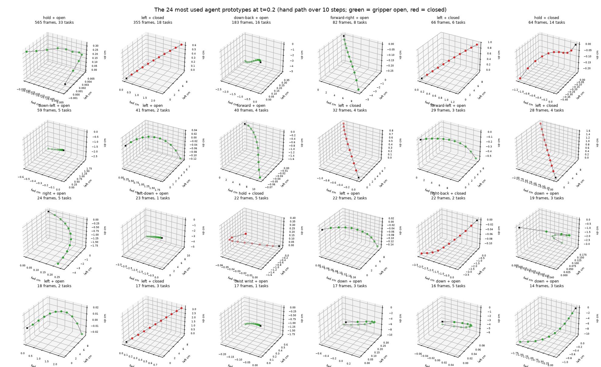
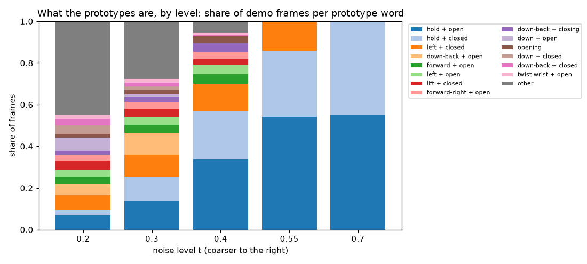
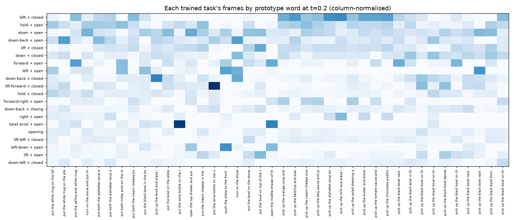

# What pi0.5's agent prototypes are

Written for: collaborators reading the embodied line.  Numbers from `ledger/r2c_atlas` (`experiments/r2c_atlas.py`);
figures in `figures/robot/atlas_*.png`.

**Setup.** The library is the 40-task tree of `r2b_marginal` (modes of pi05_libero's action marginal over 10,249 demo frames of
every task it was fine-tuned on).  A prototype is a 10-step chunk of 7-D delta commands.  Each is described by the hand's
displacement and rotation over the chunk (measured scale: a unit command moves the hand about 1.1 cm and turns it about 0.1 rad
per step; signs checked against the demos' hand positions) and by its gripper behaviour, and named by its most typical member.

| noise level t | prototypes | motion words | members sharing the prototype's word | members sharing its gripper state |
|---|---|---|---|---|
| 0.2 | 6098 | 111 | 0.90 | 1.00 |
| 0.3 | 1936 | 109 | 0.57 | 1.00 |
| 0.4 | 242 | 73 | 0.31 | 0.99 |
| 0.55 | 3 | 3 | 0.13 | 1.00 |
| 0.7 | 2 | 2 | 0.07 | 0.99 |

**Findings.**

1. The first question the hierarchy asks is whether the hand is holding something.  At every level, 99-100% of a prototype's
   frames share its gripper state; the two coarsest prototypes are 'gripper open' (approach, reach, release: 55% of frames,
   all 40 tasks) and 'gripper closed' (carry, place: 45%, 38 tasks).
2. The finest level is a vocabulary of motion primitives: 90% of a prototype's members move the same way.  The most used, by
   share of frames: left + closed (7%, 25 tasks); hold + open (7%, 35 tasks); down + open (6%, 39 tasks); down-back + open (5%, 37 tasks); lift + closed (5%, 35 tasks); down + closed (4%, 35 tasks); forward + open (4%, 25 tasks); left + open (3%, 12 tasks); down-back + closed (3%, 34 tasks); lift-forward + closed (3%, 27 tasks).
3. Between them the prototypes group frames by phase and posture rather than by direction: at t = 0.4 only 31% of a
   prototype's members share its motion word, and the coarse modes are slow ('hold') because a mode of a blurred mixture sits
   where many motions overlap.  The mid levels are where tasks share prototypes (Section 10 of the plan: at t = 0.4, 242
   prototypes, about three tasks each).
4. Motions are shared across tasks, which is why a motion alone cannot name the task it came from (the prompt-program test).

Coarse-to-fine (the top of the tree, children by frames):

- t=0.7: **hold + open** (5630 frames, 40 tasks)
  - t=0.55: **hold + open** (5548 frames, 40 tasks)
    - t=0.4: 111 children; by frames: hold + open (3444), forward + open (481), left + open (469), forward-right + open (359), down-back + closing (286), opening (186), twist wrist + open (122), right-forward + open (26)
- t=0.7: **hold + closed** (4619 frames, 38 tasks)
  - t=0.55: **hold + closed** (3269 frames, 38 tasks)
    - t=0.4: 104 children; by frames: down-back + closing (143), opening (131), lift-right + closed (88), twist wrist + closed (69), down-back + closed (67), hold + closed (53), right + closed (45), right-forward + closed (32)
  - t=0.55: **left + closed** (1432 frames, 26 tasks)
    - t=0.4: 27 children; by frames: hold + closed (2339), left + closed (1322), lift + closed (260), down-left + closed (17), forward + closed (6), left-down + opening (4), forward-up + closed (4), down-back + closed (4)

