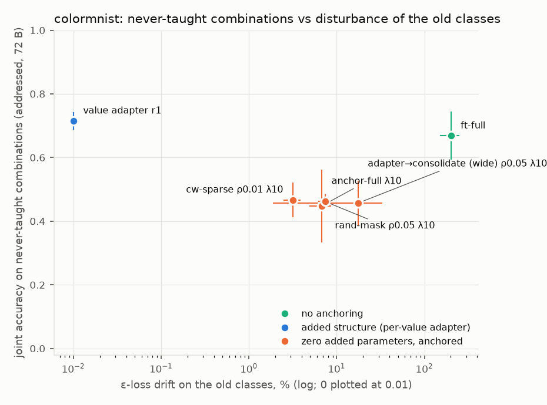
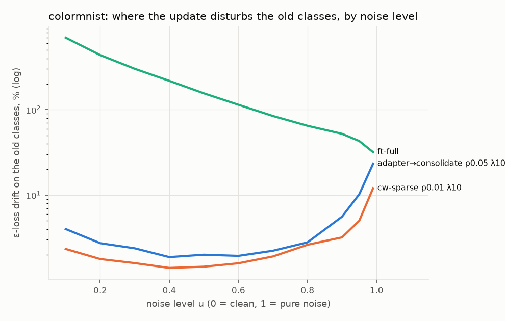
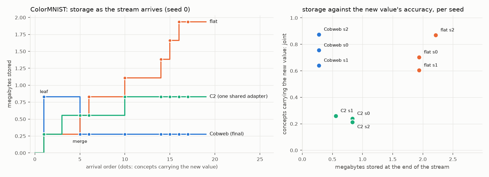
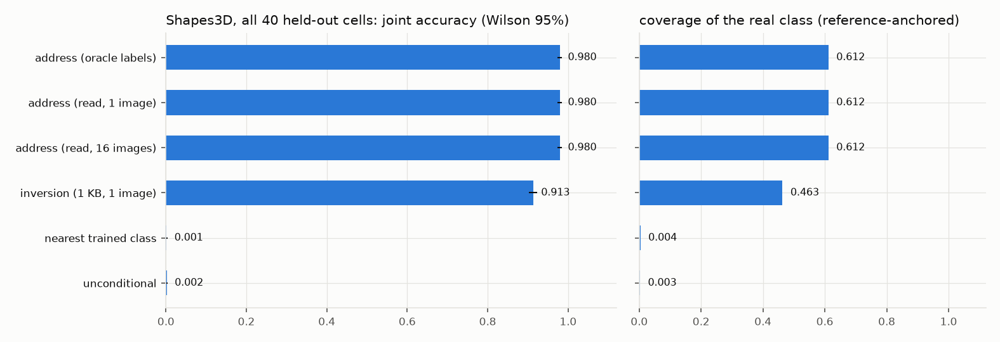

# Review, September 2026: what the repository showed, what was wrong, and what now holds

Written 2026-09-25 for the project owner's review, before any agent work. It has three parts:

1. **The audit.** What an independent, code-level check of the repository found, and what was fixed.
2. **The theory.** Why a diffusion model's update is a Cobweb update (`docs/COBWEB_UPDATE.md` has the
   proofs).
3. **The two mechanisms, on two image datasets.** The Cobweb-form continual update (C1) and the
   three-tier loop run end to end with the router deciding (C2), plus an honest remeasurement of the
   Shapes3D flagship (C3).

Every number below is produced by a script in `experiments/c_report.py` or quoted from a named result
file. Numbers marked *(seed 0)* are single-seed.

---

## Part 1 — The audit

Five independent audits (flagship pipeline, router, metrics, number provenance, tier/baseline design)
plus direct verification. Each row below was confirmed in code or in the recorded result files.

### Faults that changed a headline

| # | finding | evidence | status |
|---|---|---|---|
| 1 | The Shapes3D storage loop (§7kk, "storage cost +0.000, forgetting +0.000") never sampled the adapter it trained | `sample_concept`'s VE branch called `field.sample` outside `bank.activate`; `address` and `stored` rows identical to 16 digits on 5/5 concepts | **fixed** (9826bd5) + `tests/test_sample_concept_path.py` (fails on the old code); n77-s3d re-run under `_s3d_vefix` |
| 2 | Every storage/BLOCK arm is self-distillation | the pool is sampled from the address itself, the embedding pinned to it, B=0 init | design limitation; C1 replaces it with real-data updates |
| 3 | The Shapes3D flagship (§7jj, 0.983) composed from TRUE labels, on a fine-tuned backbone whose pretraining contains the held-out images, over the first 12 of 40 cells in slot order; its retrieval baseline is ~0 by construction | `n78:96`, `n57:105`, n74's own docstring, `n78:82` | remeasured in C3 |
| 4 | **The Shapes3D loader read the wrong image rows** whenever `fix_nuisance` or `value_stride>1` was used | image/label agreement: stride-1 + pinned wall = a consistent relabelling (the "floor_hue" factor is the WALL, 100%); stride 2 = object label at chance (0.10) | **fixed** (d8298e1, `rows="correct"`; legacy kept for old checkpoints) + `tests/test_shapes3d_rows.py` |
| 5 | EXTEND BASIS's 0.755 is on a value the backbone was trained on; on a genuinely new value it renders 0.000 | RESULTS §5q Phase A vs Phase B | C1 is built on exactly this gap |
| 6 | The router never consults the basis (`s_vocab` is a trained-class score) and never drives storage in any experiment; the 9.5×/8.9×/12.4× savings are a no-model simulation with ground-truth tiers (the CelebA row is random bit-vectors: cache filename mismatch) | `router.py:208`, `n18:279`, `n24:27,181` | C2 is the first end-to-end run |
| 7 | "Coverage" was measured with pixel k=3 recall, which rewards diversity: unconditional samples score recall 1.000 at precision 0.000 in 9/12 flagship cells | `evals.py:270`, n78 rows | all c-series runs report reference-anchored coverage |
| 8 | §28's "our composer is a workaround (4.5×)" is a 2-case, 3-epoch smoke run; the full run gives composer 0.446 vs score-addition 0.180 on the class table | `n43_conditioning_smoke` vs `n43_conditioning` | docs to be corrected |

### Smaller confirmed faults, fixed (c15397a)

* **Instrument gate resolution** used a Wald interval, which collapses at p ∈ {0,1} (the flagship's
  "resolution 0.000"). It now uses a Wilson half-width: 0.071 at p=1, n=24.
* **Inception features:** the network was built with `transform_input=False`, so inputs were about
  2.2× off scale. Fixed; `LOL_INCEPTION_LEGACY=1` reproduces the pinned numbers.
* **N5's image-quality retention column** logged one value per concept, so "FR +0.000" was structural.
* **n84/n85** saved `margin.vs_poe = NaN` because of an arm-key mismatch.

### Open, not yet fixed (they touch pinned numbers; see Part 4)

* `aggregate.py _agg_rows` keeps only the first composition per seed (n27/n28).
* n24's CelebA cache lookup.
* Stale document numbers: the README quotes a superseded 0.605 where the canonical run gives 0.630;
  "538×" divides parameters by bytes (it is 2,154×); the README carries two incompatible tier tables;
  "0.25 bit-identical" is 1/(number of batches).
* `test_claims.py` reads only aggregate means, with tolerances loose enough to pass stale runs.

---

## Part 2 — The theory: a diffusion model's update is a Cobweb update

Proved in `docs/COBWEB_UPDATE.md` and checked numerically in `tests/test_cobweb_correspondence.py`
(errors ~1e-15):

* **The exact update.** For the Bayes-optimal denoiser of an empirical distribution, adding one
  instance changes the posterior mean and covariance by exactly Cobweb's incremental mean/variance
  update. Cobweb's hard share 1/(c+1) is replaced by the new instance's soft posterior responsibility
  r(x_t), and this happens at every noise level at once.
* **Noise level is the depth of the tree.** At high noise r → 1/(n+1): the root's minuscule running-mean
  step, shared by everything. At low noise r → 1 near the new instance and 0 elsewhere: a leaf that owns
  only itself.
* **Locality in the ideal model.** Interference with an old concept is bounded by the new instance's
  responsibility at that concept.
* **The weight-space counterpart.** A 1/(n+1) natural-gradient step. Under a diagonal Laplace model,
  the best k-parameter support is the top-k by g²/F.
* **Which factor is new (Proposition 7, added in this iteration).** Under the repository's additive
  conditioning, one concept cannot say which of its factors carries a new value: a new vector on any
  factor fits it exactly. Two concepts that share the value can, once they differ on every other
  factor. Any router that attributes a new value from its first concept is guessing. Cobweb resolves
  the same ambiguity with `create` and `merge`, and the router in Part 3c now does the same.

**What the experiments add to the theory (C1).** The network does NOT inherit the ideal model's
locality. The two halves of the proved update have to be implemented explicitly:

* **the r ≈ 1 half:** fit the new instance's inputs;
* **the r ≈ 0 half:** hold the old inputs' outputs fixed on the model's own samples.

A sparse parameter mask alone does not implement the second half. See Part 3.

---

## Part 3 — The two mechanisms on image datasets

### How each reading of "a sparse, Cobweb-like update" was tested

The request was to change "very remote and minuscule functionality without touching the broader
hierarchy", or equivalently to add something to the hierarchy the diffusion model extracted and
recompose it into the weights. Each reading below became an arm or an operator with a measurement.

| reading | what was built | where | outcome |
|---|---|---|---|
| change a minuscule set of **weights** | top-1% of weights by g²/F (Proposition 6); a random 5% mask; the conditioning pathway only | C1 arms `cw-sparse`, `rand-mask`, `cw-cond` | sits on a plasticity/stability frontier; a random mask ties g²/F, so the mask is a capacity knob |
| do not touch **old functionality** | hold old outputs fixed on the model's own samples (the r ≈ 0 half of Proposition 2) | the anchor term in every zero-structure arm | what actually preserves; without it, 1% of weights drifts as much as full fine-tuning |
| **add a node** to the extracted hierarchy | a gated adapter on a VALUE of the factor hierarchy, on only when that value is present | C1 `value-lora`; C5 value nodes | old classes exact; never-taught combinations addressable at 72 B |
| **recompose** the hierarchy into the weights | the node's adapter distilled into the backbone, then zeroed | C1 `lora-consol`, `lora-consolw` | zero added parameters, but pays about the drift it saves |
| Cobweb's **operators** on concepts | create a leaf, merge it into a value node when a second concept shares it, incorporate (refine) | C5 | Part 3c |
| the **noise-level** hierarchy | Propositions 3–4: high noise is the root, low noise the leaves | C1's drift by noise level | the network interferes MOST at low noise, the opposite of the ideal model |

### 3a. Mechanism A — teaching a value the backbone has never rendered (C1)

**The test.** The ColorMNIST backbone (`nobg3`) was trained with background 3 withheld entirely. The
stream runs as follows:

* **Tasks.** 4 tasks of 3 concepts (d, f, bg = 3), each taught from 64 real images, with digits and
  foregrounds distinct inside a task.
* **Conditioning.** Every concept is conditioned through the basis plus ONE learned direction for the
  new value.
* **Addressability.** After each task, 8 never-taught (d, f, 3) combinations are generated from their
  coordinates alone (72 B). This is the test of whether the value entered the vocabulary.
* **Retention.** Old-class retention is measured on 12 trained classes (joint accuracy) and on 120
  (ε-loss drift at every noise level).

**The arms.** Each arm differs only in what may move. Every arm runs the same absorb-until-in-
distribution stop rule: noise levels u ≥ 0.3 plus u = 0.95 and 0.99, with a 5% margin.

**The result.** 3 seeds, last task, mean ± SE (`results/c1_colormnist_final_table.txt`):

| what may move | added storage | taught | never-taught (72 B) | old-class drop | ε-drift |
|---|---|---|---|---|---|
| the new direction only (EXTEND) | 1 KB | 0.000 | 0.000 | 0 | 0% |
| **one gated rank-1 adapter per VALUE** | 276 KB per value | **0.716 ± 0.011** | **0.715 ± 0.027** | **0.000** | **0%** |
| sparse 1% of weights (g²/F), anchored λ=10 | 0 | 0.509 ± 0.074 | 0.467 ± 0.054 | 0.056 ± 0.035 | 3.2% |
| sparse 1%, anchored λ=30 | 0 | 0.450 ± 0.074 | 0.417 ± 0.056 | 0.037 ± 0.016 | 2.2% |
| random 5% of weights, anchored λ=10 | 0 | 0.508 ± 0.032 | 0.462 ± 0.023 | 0.065 ± 0.030 | 7.4% |
| every weight, anchored λ=10 | 0 | 0.493 ± 0.115 | 0.448 ± 0.114 | 0.063 ± 0.002 | 6.8% |
| adapter, then consolidated into the weights (wide) | 0 | 0.433 ± 0.069 | 0.457 ± 0.070 | 0.20 ± 0.19 | 17% |
| every weight, no anchoring | 0 | 0.725 ± 0.083 | 0.668 ± 0.075 | **0.572 ± 0.081** | **200%** |

**What this establishes.**

1. **Conditioning alone cannot render a new value** (0.000, 3/3 seeds). This replicates Phase B.
   Something in the network has to change.
2. **A per-VALUE gated adapter solves the task.** It renders the new value on taught concepts (0.72).
   It makes the value addressable on never-taught combinations at 72 B each (0.72). It leaves every old
   class exactly as it was, and it costs one adapter per value, not per concept.
   * **This is the hierarchical adapter layout placed correctly.** The node is a VALUE in the factor
     hierarchy extracted from the backbone's class table, not a concept leaf in a tree built over
     concept means (which §24 refuted).
   * **It is also the network's realisation of the responsibility in Part 2.** The gate switches the
     change on exactly where the value is present (r = 1) and nowhere else (r = 0).
3. **Parameter sparsity is not functional sparsity.** Moving only 1% of the weights, chosen by the
   Laplace-optimal g²/F rule, *without* anchoring is as destructive as full fine-tuning (sweep: 508%
   drift at u = 0.1; old backgrounds read 0.23). A random mask with anchoring does as well as the g²/F
   mask. The mask is a capacity knob; the anchor does the preserving.
4. **The network does not inherit the ideal model's locality.** Interference is LARGEST at low noise,
   where Proposition 4 would make it smallest. Fine-scale denoising runs through weights every class
   shares.

   
5. **Zero-structure updates therefore sit on a plasticity/stability frontier** that the per-value adapter
   dominates. The best of them reach about 0.45 on never-taught combinations at 2–7% drift.
   Consolidating the adapter into the weights keeps the parameter count at the base model's, but so far
   pays about as much drift as it saves in structure. One seed of three destabilised.

**The stop rule is a weak proxy.** Absorbing "until the concept's loss is at the trained-class level"
stops the zero-structure arms at about 400 steps, with the new value rendered only about 67% of the
time. The loss criterion certifies denoising, not generation. An earlier sweep with a looser stop rule
ran the anchored zero-structure arms to about 450–790 steps. On the last task they reached taught
0.65–0.70 at 1.5–3.4% drift (seed 0: sparse 1% 0.653 at 1.5%, random 5% 0.660 at 3.4%,
adapter-then-consolidate 0.701 at 3.3%). That is the other end of the same frontier.

### 3b. Mechanism A on Shapes3D

*(running: pretrained eurecom backbone, new value = a grey wall)*

### 3c. Mechanism B — the three-tier loop, end to end (C2 → C4 → C5)

**The test.** A stream of 20 concepts arrives, each as 64 real images. The router is not told which
population a concept comes from:

* 4 are trained classes and should store nothing;
* 8 are untrained combinations of known values and should be ADDRESSED;
* 8 use the new value and should create one value node, after which the rest should be addressed.

Every threshold is calibrated on the backbone's trained classes only. Three questions are scored
separately: which tier each concept got, whether it was stored under its true coordinates, and
whether samples from what was stored show the concept.

**C2, the loop as first built, fails on the new value** (3 seeds, `results/c2_router_loop_colormnist_F*`):

| variant | new-value joint | stored under the true tuple | old classes |
|---|---|---|---|
| label-free attribution, one shared adapter | 0.248 ± 0.009 | 0.08 | exact |
| the true factor supplied (oracle attribution) | 0.276 ± 0.095 | 0.42 | exact |
| sparse weight mask in place of the adapter | 0.076 ± 0.027 | 0.42 | 0.834 → 0.756 |

The logs show two separate causes:

1. **Attribution from one concept is a guess.** In FLI seed 0, the first new-background concept was
   attributed to the foreground factor. Six later new-background concepts then reused that wrong
   node and scored 0.000. Proposition 7 says no score can fix this: one concept is explained equally
   well by a new value on any factor.
2. **One shared adapter.** C2 has a single adapter, switched on by every node that has one. In FLO
   seed 0, a new combination was escalated and created a second background node. Its training
   overwrote the adapter that the real new background used.

**C4 scores each decision alone** on every concept (94 on ColorMNIST, no state carried between
concepts; `results/c4_router_diag_colormnist_*`):

* **Novel or not** (best trained row against the trained-class level). AUROC 1.000. At C2's
  threshold (the 90th percentile of trained classes), 12% of trained classes still fail it by
  construction. That is why the final router uses the worst trained class.
* **Address or new node.** The informativeness rule C2 used fails structurally. A trained class
  whose background is value 0 scores about 0 on the background factor (0.01–0.09), because value 0
  sits near the basis mean. So every background-0 combination looks novel, and at C2's operating
  point it addresses only 77% of new combinations. A different label-free
  signal separates the populations: **does composing beat retrieving?** Take the best basis
  address's worst decision level, divided by the best trained class's:
  * a new combination has every value right in the address, while the nearest trained class is off
    in one factor, so the ratio is 0.35–0.72 (all 30);
  * a concept with a new value makes both fall back on the nearest known value, so the ratio is
    0.82–1.16 (all 40).

  AUROC 1.000. At 0.9 (the address must beat the best trained class by 10%) it addresses all 30 new
  combinations and 3 of 40 new-value concepts.
* **Which factor.** Informativeness names the new factor for 0.42 of new-value concepts, near the
  chance rate of 0.33 for three factors. The read of the OTHER factors is corrupted too: it is right
  for 0.15 of new-value concepts, against 1.00 for trained classes and new combinations. Foreground
  is read as 3, and a digit often as 1, for most of the 40.

**C5 rebuilds the loop with Cobweb's operators** (`experiments/c5_router_cobweb.py`). It uses the
same stream and calibration as C2, with these changes:

* every node owns its adapter (`KeyedLoRA`);
* a concept that is neither in-distribution nor addressable creates a **LEAF** holding one hypothesis
  per factor, whose other factors are read with that factor left out;
* a later concept that a hypothesis explains better than any basis composition **MERGES** the leaf
  into a value node on that factor;
* concepts read through a node are **incorporated**, updating the node at 0 B.

**The result on ColorMNIST.** Three seeds per row, joint re-sampled at the end of the stream
(`experiments/c_report.py c5`):

| router | trained classes store nothing | new combinations ADDRESSED | new-value joint | new-value stored under true tuple | never-taught new-value combinations | storage | new-value merges on the right factor |
|---|---|---|---|---|---|---|---|
| C2: informativeness, one shared adapter | 0.92 | 0.92 | 0.238 ± 0.014 | 0.08 | – | 0.74 MB | – |
| C5: informativeness rule, refine at merge | 0.92 | 0.75 | 0.580 ± 0.055 | 0.50 | – | 1.02 MB | 4 / 5, plus 2 merges of junk leaves |
| C5: compose-vs-retrieve rule | 0.92 | **1.00** | 0.458 ± 0.057 | 0.46 | – | 0.37 MB | 3 / 3 |
| C5: compose-vs-retrieve, IN-DIST at the worst trained class | **1.00** | **1.00** | 0.460 ± 0.059 | 0.46 | 0.399 ± 0.065 | **0.278 MB** | 3 / 3 |
| **C5 final: the above + incorporate** | **1.00** | **1.00** | **0.757 ± 0.068** | 0.63 | **0.611 ± 0.099** | **0.278 MB** | **3 / 3** |
| flat: one adapter per escalated concept, same rules | 1.00 | 1.00 | 0.726 ± 0.078 | 0.17 | 0.483 ± 0.153 | 2.03 MB | – |

Old classes are exact in every C5 row (0.834 → 0.834), because a node's adapter is off unless its
value is in the coordinates.

**What this establishes for mechanism B.**

1. **Every tier decision is right, label-free, in 3/3 seeds.**
   * Trained classes store nothing.
   * All 24 new combinations are addressed under their exact tuple.
   * The first new-value concept becomes one leaf, which the next new-value concept merges on the
     right factor.
   * Every later new-value concept is stored at 72 B.

   Storage for the eight new-value concepts is one adapter: 277.6 KB, 7.3× less than the flat store.
2. **The hierarchy beats flat on accuracy, too, once nodes incorporate their members.** New-value
   concepts reach 0.757 against 0.726. Never-taught combinations of the new value reach 0.611 against
   0.483, rendered from 72 B of coordinates through the node. C1's per-value adapter, trained with
   the TRUE labels, reaches 0.715 on never-taught combinations. The label-free loop recovers most of
   that.
3. **Each fix moves exactly the number it targets.**
   * Compose-vs-retrieve removes the over-spend on new combinations: 0.75 → 1.00 addressed, and
     1.02 → 0.37 MB.
   * The worst-class IN-DIST threshold stops trained classes from becoming leaves: 0.92 → 1.00.
   * Incorporate lifts both accuracies: 0.46 → 0.76 on new-value concepts and 0.40 → 0.61 on
     never-taught ones. It did not pollute the node.
4. **What remains is reading.** Only 0.63 of new-value concepts are stored under their true tuple.
   The joint is higher than that because the node learns to render each concept from its (partly
   misread) coordinates. See Part 4.

### 3d. The Shapes3D flagship, remeasured (C3)

The audit found four problems with §7jj's 0.983:

* it composed each cell from its TRUE labels;
* it scored the first 12 of 40 held-out cells, in slot order;
* its baseline was 0 by construction;
* its "resolution" came from a Wald interval evaluated at p = 1.

C3 re-runs it on the same backbone and split. It scores all 40 cells, reads the factors from the
query images, adds a baseline that can win, and draws 3 sampling seeds of 24 samples per cell
(`results/c3_flagship_ALL__seed0.json`):

| arm | stored | joint (Wilson 95%) | coverage | memorised |
|---|---|---|---|---|
| address, true labels | 72 B | 0.980 [0.974, 0.984] | 0.612 | 0.001 |
| **address, factors read from ONE query image** | 72 B | **0.980 [0.974, 0.984]** | 0.612 | 0.001 |
| address, read from 16 images | 72 B | 0.980 | 0.612 | 0.001 |
| inversion: a free 1 KB vector fitted to the same one image | 1 KB | 0.913 [0.902, 0.923] | 0.463 | 0.007 |
| nearest trained class | 0 | 0.001 | 0.004 | 0.095 |
| unconditional | 0 | 0.002 | 0.003 | 0.090 |

**What stands.** The number survives: 0.980 over all 40 cells. The router's read is exact, in 40 of
40 cells from a single image. The samples are not memorised, and the Wilson interval is real.

**What changes.**

* **The address beats a fair baseline on storage, and only modestly on accuracy.** A 1 KB inversion
  from the same image reaches 0.913. The address is 14× smaller and 0.067 more accurate. The
  "retrieval 0.010" contrast measured nothing, because the nearest trained class differs from every
  target in one factor by construction.
* **Coverage is 0.61.** The samples show the right cell but cover about 61% of its real scale and
  orientation variation (vendi 1.16).
* **The claim is addressing, not generation.** The eurecom pretraining contains every held-out
  cell's images. So this shows that 72 B of coordinates reach combinations the backbone can already
  draw. It does not show generation of unseen combinations; C1 and C5 on ColorMNIST test that.

## Part 4 — What this means for the thesis

### Claim by claim

| thesis claim | status | evidence |
|---|---|---|
| Compositionality serves lifelong learning: new combinations of known parts need no new parameters | **holds** | ColorMNIST new combinations: 72 B each, routed label-free, all 24 under their exact tuple, joint 0.688 ± 0.018 (trained classes 0.851). Shapes3D: 0.980 from a 1-image read (C3); ADDRESS 1.000 in C2 |
| A Cobweb-like weight update, with a proof | **holds for the ideal denoiser; the network needs the r ≈ 0 half made explicit** | Propositions 1–6. The network does not inherit locality (C1): interference is largest at low noise. The preserving half is anchoring or gating |
| Three tiers ADDRESS 72 B / EXTEND 1 KB / BLOCK | **the middle tier changes** | EXTEND alone renders a genuinely new value at 0.000 on both datasets. The working middle tier is a VALUE NODE: the 1 KB direction plus one gated adapter, paid once per value |
| Hierarchical adapter layout: adapters grow with the number of values, not concepts | **holds** | C5 final: one adapter for all eight new-value concepts (277.6 KB against the flat store's 2.03 MB, 7.3×), and more accurate than flat: 0.757 against 0.726 on the concepts, 0.611 against 0.483 on never-taught combinations. With true labels (C1), never-taught combinations render at 0.72 (ColorMNIST) and 0.94 (Shapes3D) |
| The router decides from s_novel / s_vocab | **s_novel holds; s_vocab and attribution were rebuilt** | Novelty: AUROC 1.000. Address-vs-node: compose-vs-retrieve, AUROC 1.000 (informativeness fails structurally on values near the basis mean). Attribution: informativeness is at chance (0.42 against 0.33); a second concept is needed (Proposition 7), and C5's leaf/merge chose the right factor in every final run |
| Sparse updates change remote functionality without touching the hierarchy | **parameter sparsity does not; functional sparsity does** | 1% of weights moves old outputs as much as full fine-tuning unless anchored. A gated node is exact because it is off wherever its value is absent |
| Recompose the hierarchy back into weights | **open** | Consolidation pays about the drift it saves (ColorMNIST 17% ε-drift; Shapes3D old classes −0.12) |

### What is not yet measured

The thesis lists these, and the c-series does not yet cover them:

* batch-size invariance (every concept here arrives as one batch of 48–64 images);
* representational probes (linear probe or kNN on the stored representations);
* wall-clock training time per tier;
* CelebA;
* a c-series comparison against Wang et al. (`poe-guided` exists in the earlier n-series).

### The open problem that bounds mechanism B

The router reads a concept's KNOWN factors from ε-losses. When the concept also carries a new value,
the new value corrupts those reads. On ColorMNIST, foreground is read as the same value for most
new-background concepts, whether the background is included in the read or left out. A misread
concept stored at a node has two possible outcomes:

* without incorporate, its samples are wrong;
* with incorporate, the node learns to render it correctly from the wrong coordinates. On ColorMNIST
  that did not hurt never-taught combinations (0.40 → 0.61), but the stored coordinates stay wrong,
  and a node that has learned several misreadings is harder to reuse or to inspect.

The flat store avoids reading, and pays 7.3× the storage to do so. The final router recovers the
accuracy by incorporating, but it stores 37% of new-value concepts under wrong coordinates. Three
candidate fixes:

* re-read the known factors by optimisation while the node trains (soft coordinates);
* a backbone whose conditioning is disentangled per factor (separate tokens rather than one
  additive vector);
* a discriminative reader for the known factors alongside the density-based novelty test.

### Before agent work (for after this review)

The one-to-one mapping to a vision-language-action (VLA) setting carries over (memory:
`task_definition_lifelong_composition`): factors are object, goal and scene; a new value is a novel
object; a value node is a per-object adapter in a diffusion policy; ADDRESS is a new task composed
from known parts. Three results above set the prerequisites:

1. the policy's conditioning must be factored, or attribution is unidentifiable (Proposition 7);
2. new-value storage should be a gated node, not a sparse weight edit (C1);
3. reads of known factors must survive a novel one before the hierarchy's storage advantage comes
   without a fidelity cost.
